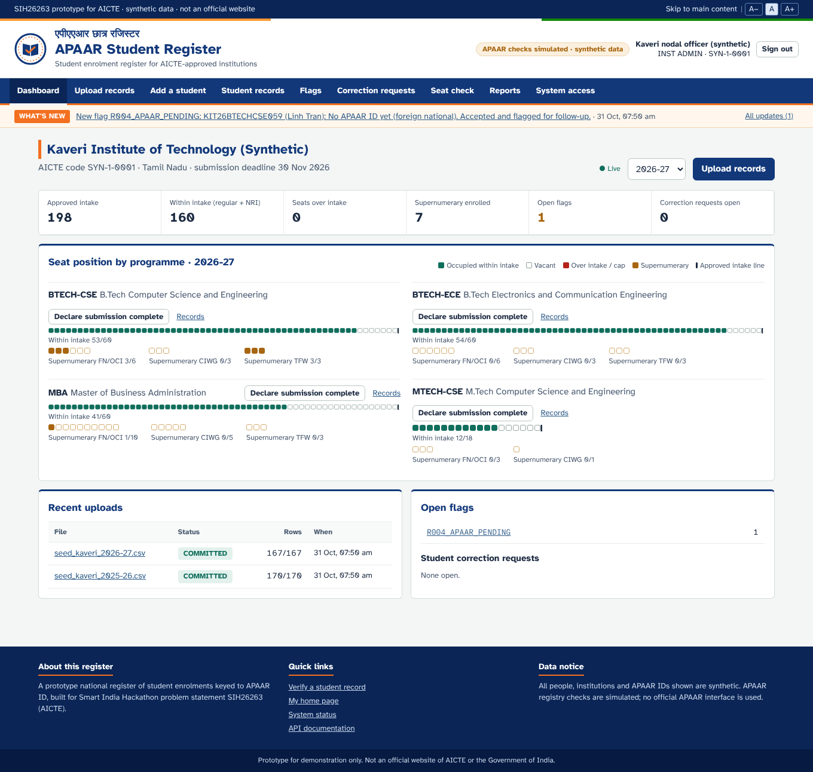
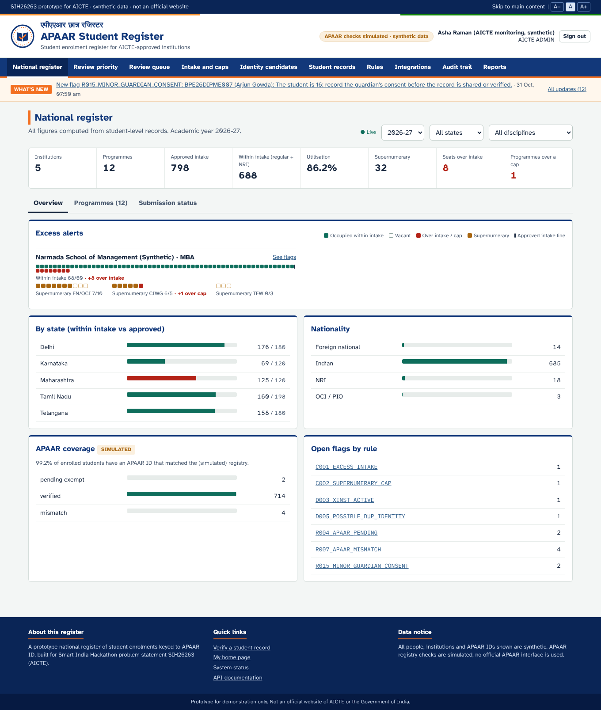
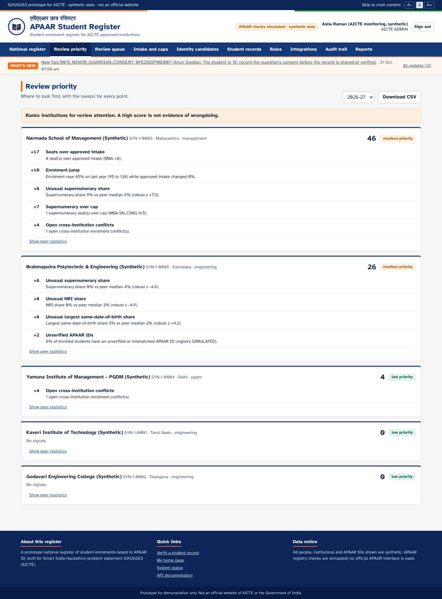
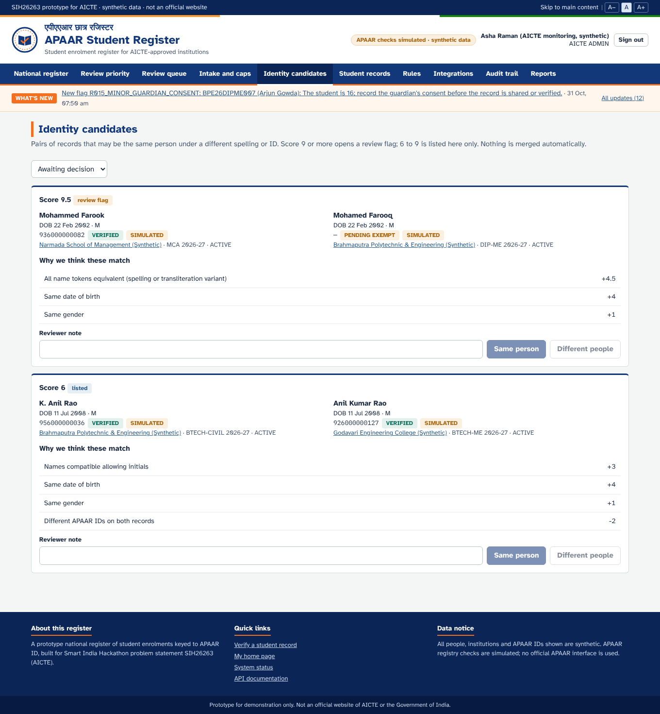
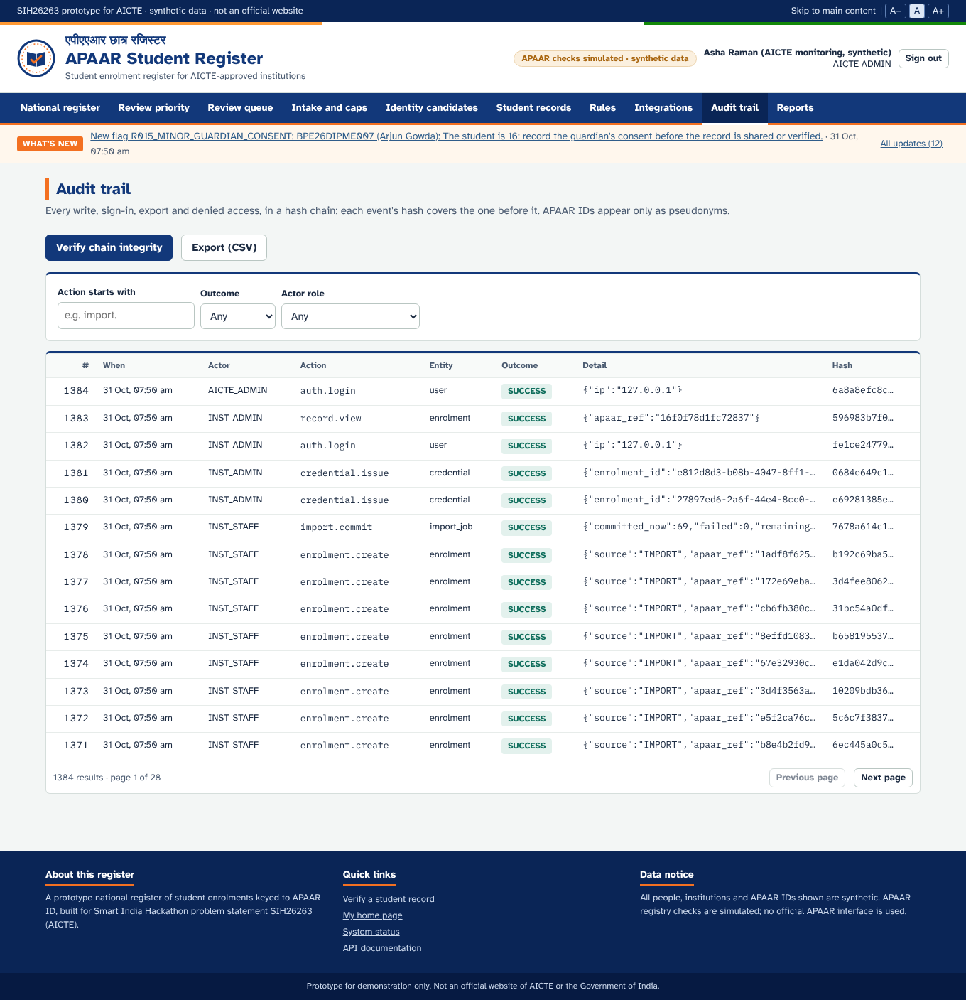
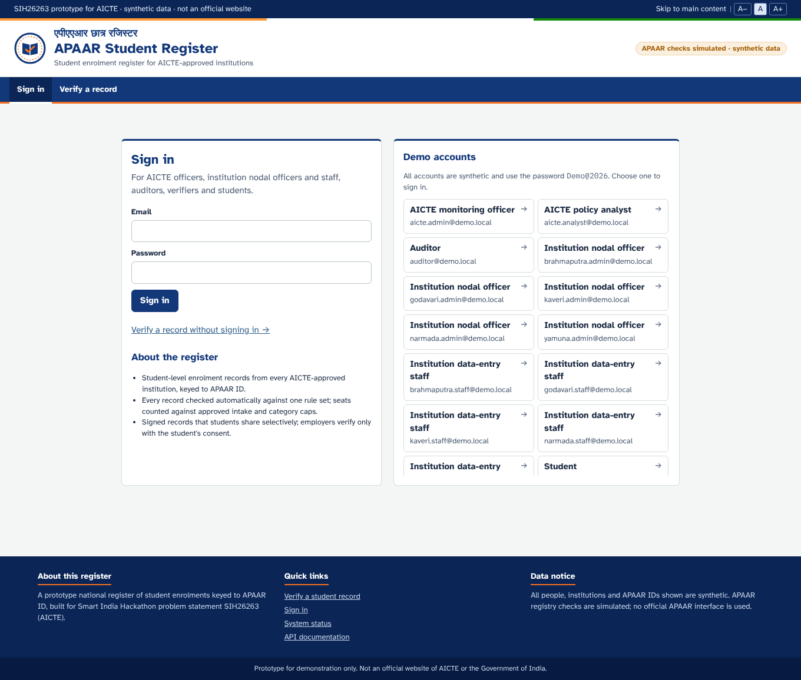
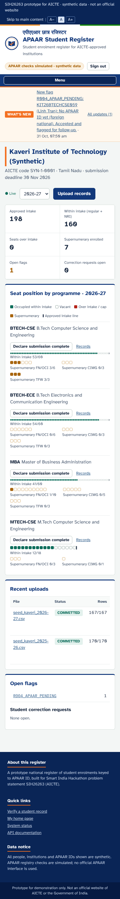
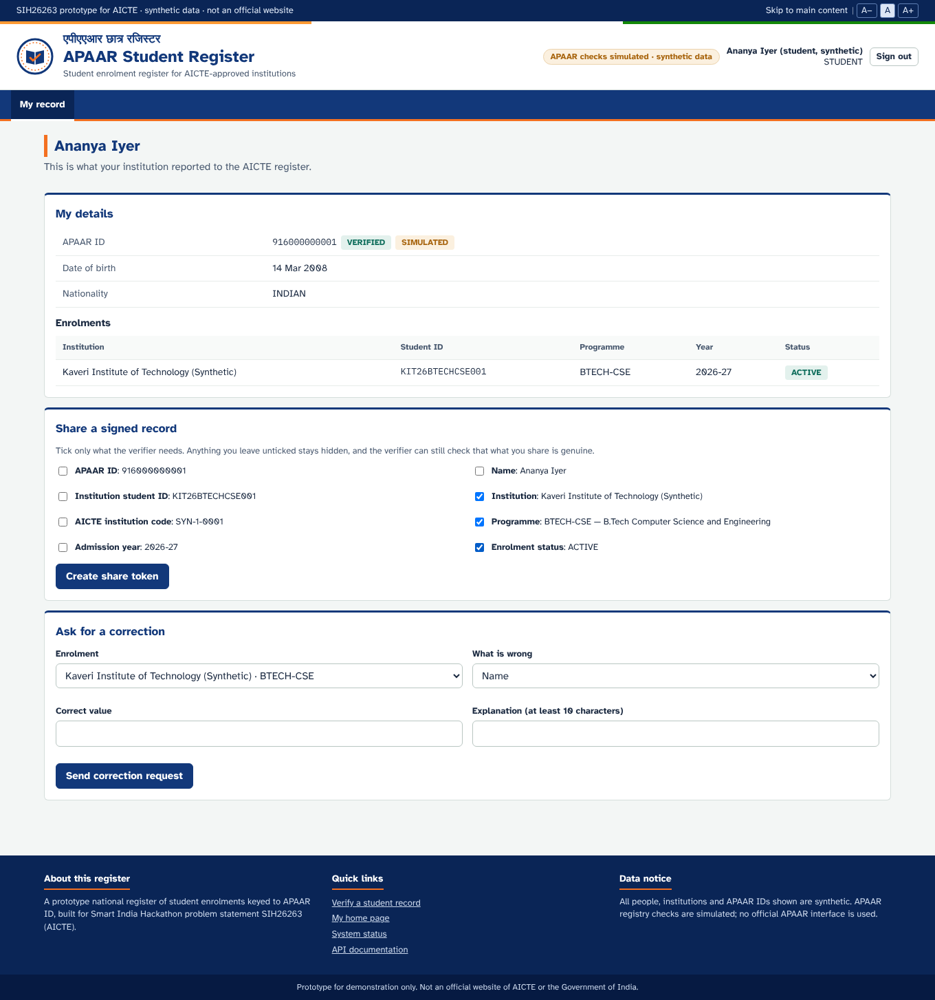
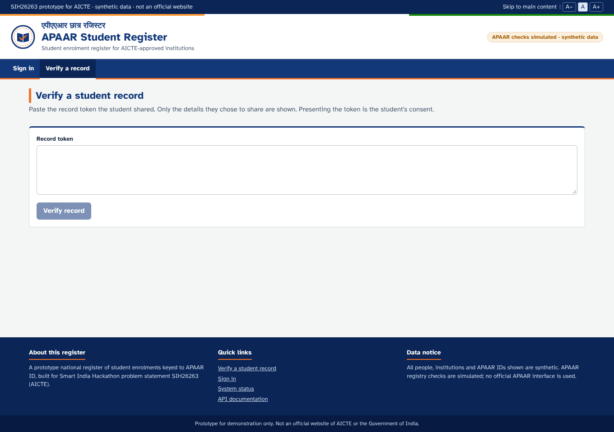
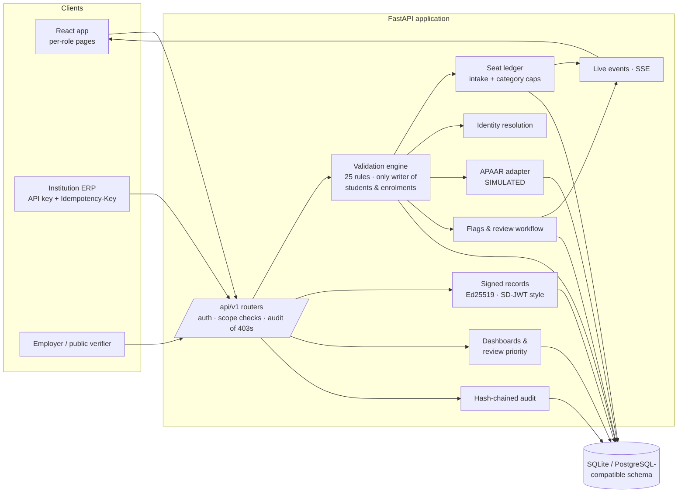

# APAAR Student Register

**APAAR-Based Student Data Management and Verification System: a working prototype for Smart India Hackathon problem statement SIH26263 (AICTE).**

A national register of student enrolments for AICTE-approved institutions. Every record is keyed to the student's APAAR ID, checked automatically against one shared rule set, counted against the programme's approved intake, and verifiable by employers only with the student's consent.

> [!IMPORTANT]
> **Synthetic data only.** Every person, institution and APAAR ID in this repository is invented. Synthetic APAAR IDs are 12 digits starting with `9`.
> **APAAR registry verification is SIMULATED** against a synthetic registry table, because no official APAAR API contract was available. Every screen and API response that shows an APAAR check is labelled `SIMULATED`.



---

## Contents
- [The problem](#the-problem)
- [What the prototype does](#what-the-prototype-does)
- [Quick start](#quick-start)
- [Demo accounts](#demo-accounts)
- [Three demos](#three-demos)
- [Screenshots](#screenshots)
- [Look and feel](#look-and-feel)
- [Architecture](#architecture)
- [How "excess" is counted](#how-excess-is-counted)
- [Validation rules](#validation-rules)
- [Security and privacy](#security-and-privacy)
- [API](#api)
- [Testing](#testing)
- [Configuration](#configuration)
- [Project layout](#project-layout)
- [What is live, simulated or planned](#what-is-live-simulated-or-planned)
- [Documentation](#documentation)

---

## The problem

Today AICTE receives student-level data only from PGDM institutions; most others report totals. Totals cannot show who is enrolled, whether the same student is counted twice, or whether a programme admitted more students than it was approved for. SIH26263 asks for:

- student-level records keyed to APAAR ID, collected from every institution after admissions;
- automatic validation;
- real-time monitoring of excess admissions;
- secure verification for AICTE, institutions and employers.

## What the prototype does

| Capability | What you can see working |
|---|---|
| **Prevention, not just detection** | A **seat-check** (screen and API) tells an institution *before* admitting whether a student fits within approved intake or a category cap. The upload preview shows the seat position before and after committing. |
| **Rule-faithful seat counting** | Regular and NRI seats count against approved intake. Each supernumerary category (FN/OCI, CIWG, TFW) counts only against its own cap, with the rule source recorded. Unused seats are never transferred. |
| **One rule set for every channel** | Spreadsheet upload, manual entry and the institution-system (ERP) API all run the same **25 named rules**. Each finding carries an ID, severity, evidence and how to fix it. |
| **Guided correction** | Fix rows inline without retyping; a "did you mean" suggestion for a mistyped APAAR ID; fix the same problem in every row; leave a row out; commit the good rows now and the rest later. |
| **Indian-name-aware identity matching** | Finds the same person under spelling variants, initials and reordered names (e.g. *Subramaniam / Subramanian*, *K. Anil Rao / Anil Kumar Rao*), and shows *why* it thinks so. Nothing is merged automatically. |
| **Privacy-preserving conflict detection** | When a student is active at two institutions, both are flagged, but each institution sees the other only as *"Another AICTE-approved institution (identity withheld)"*. AICTE sees both. |
| **Review workflow** | Flags mean "a person should look", never "fraud". AICTE requests clarification, institutions respond, AICTE resolves or dismisses. Only a capacity flag can close itself, when its condition disappears; that is logged and can be reopened. |
| **Live dashboards** | Institution and national dashboards update without reloading (server-sent events). A review-priority ranking explains every point and always states that a high score is not evidence of wrongdoing. |
| **Signed, selectively disclosed records** | Ed25519-signed records in the SD-JWT style. The student chooses which details to share (e.g. institution and status, but not the APAAR ID), and a verifier checks them without signing in. Includes revocation, QR codes, and a printable certificate showing the APAAR ID next to the institution student ID. |
| **Consent-based verification** | An employer needs the APAAR ID **and** date of birth; the response is identical whether or not they match; the student approves or declines; the employer then sees a fixed minimal set of fields. |
| **Student correction requests** | Students see their own record and can ask for a correction. It lands in the institution's queue with a 14-day due date. |
| **Self-service for institutions** | Add a single student through a form (same rules as uploads). Create and revoke API keys for the admission system; each key is shown once and only its hash is stored. |
| **Intake administration** | AICTE sets approved intake per programme-year and can override any supernumerary cap with a recorded rule source; capacity checks re-run immediately. |
| **Tamper-evident audit** | A hash-chained audit trail records every change, sign-in, export and **every denied access**. One click verifies the chain and names the first altered event. |

## Quick start

**Requirements:** Python 3.11+, Node 18+ and `make`. Docker is optional.

```bash
git clone https://github.com/sanjayvasudevan-c/SIH-2-PS-source_code.git
cd SIH-2-PS-source_code
make setup     # Python venv + dependencies, npm install, frontend build   (~20 s)
make seed      # reset the database and load synthetic data + sample files (~5 s)
make run       # http://localhost:8000      API docs: http://localhost:8000/api/docs
```

<details>
<summary>Without make</summary>

```bash
python3 -m venv .venv
.venv/bin/pip install -r requirements-dev.txt
(cd frontend && npm install && npm run build)
(cd backend && ../.venv/bin/python -m app.seed --reset)
(cd backend && ../.venv/bin/uvicorn app.main:app --port 8000)
```
</details>

<details>
<summary>With Docker</summary>

```bash
docker compose up --build      # seeds, then serves on http://localhost:8000
```
</details>

<details>
<summary>Development mode (hot reload)</summary>

```bash
make dev                       # backend with --reload on :8000
cd frontend && npm run dev     # Vite on http://localhost:5173 (proxies /api to :8000)
```
</details>

## Demo accounts

All accounts use the password **`Demo@2026`**. When `DEMO_MODE=1` (set by `make run`, `make dev` and docker-compose), the login page has a one-click account picker; otherwise type the email and password.

| Role | Email | Lands on |
|---|---|---|
| AICTE monitoring officer | `aicte.admin@demo.local` | National register, review queue, intake and caps, rules, audit |
| AICTE policy analyst | `aicte.analyst@demo.local` | National register (APAAR IDs masked) |
| Auditor | `auditor@demo.local` | Audit trail and chain verification |
| Employer / verifier | `verifier@demo.local` | Verify a record, request verification |
| Institution nodal officer | `kaveri.admin@demo.local` (also `godavari`, `narmada`, `yamuna`, `brahmaputra`) | Institution dashboard; can declare submission, issue/revoke signed records, manage API keys |
| Institution data-entry staff | `kaveri.staff@demo.local` (same five institutions) | Upload, fix, commit, correct records |
| Student | `student.ananya@demo.local` | Own record, consent requests, sharing, correction requests |
| Student under 18 | `student.sneha@demo.local` | Sharing and consent are held until Brahmaputra records guardian consent (rule R015) |

The seed also writes an API key for Kaveri's admission system (scopes `enrolments:write`, `seat:check`) to `var/demo_api_key.txt`.

<details>
<summary>The five synthetic institutions</summary>

| Code | Institution | Programmes (intake) | Seeded situation |
|---|---|---|---|
| SYN-1-0001 | Kaveri Institute of Technology, Tamil Nadu | BTECH-CSE (60), BTECH-ECE (60), MTECH-CSE (18), MBA (60) | Within limits; TFW full at 3/3; Ananya Iyer studies here |
| SYN-1-0002 | Godavari Engineering College, Telangana | BTECH-CSE (120), BTECH-ME (60) | CSE exactly 120/120, TFW 6/6 (Demo B pushes it over) |
| SYN-1-0003 | Narmada School of Management, Maharashtra | MBA (60), MCA (60) | MBA **+8 over intake**, CIWG 6/5 over cap |
| SYN-1-0004 | Yamuna Institute of Management – PGDM, Delhi | PGDM (120), PGDM-BA (60) | Submission declared; one student also active at Narmada |
| SYN-1-0005 | Brahmaputra Polytechnic & Engineering, Karnataka | DIP-ME (60), BTECH-CIVIL (60) | Some registry name mismatches; a possible duplicate identity |
</details>

## Three demos

Each demo works by clicking through the UI ([`docs/DEMO_SCRIPT.md`](docs/DEMO_SCRIPT.md)) and is also automated: `make demos`, run on a freshly seeded database with the server running.

1. **Demo A: ingestion.**
   - Kaveri uploads `sample_data/demo_A_kaveri_upload_2026-27.csv`, and the preview shows **5 valid / 2 review / 9 errors**.
   - They accept the "did you mean" fix for a mistyped APAAR ID, fix the other errors inline, and leave out a duplicate row.
   - They commit 15 rows. The AICTE dashboard updates live, and the name-mismatch and pending-APAAR flags appear.
2. **Demo B: conflict and excess.**
   - Godavari's seat check warns that one more admission would exceed intake by 1.
   - The upload preview shows +4. After commit, flags open for excess intake (+4), the TFW cap (7/6), a cross-institution conflict and an attribute mismatch.
   - Godavari sees the other institution withheld; AICTE sees both. Clarification, transfer, response and resolution follow.
   - Cancelling 4 admissions closes the excess flag automatically, with a logged system event.
3. **Demo C: verification.**
   - Kaveri issues a signed record. The student shares only institution, programme and status.
   - Public verification passes with the APAAR ID masked. The tamper button makes it fail, and revocation shows "Revoked on … : reason".
   - A consent-based request returns 403 until the student allows it, then shows minimal fields.
   - Another institution gets 404 on the student's record.

## Screenshots

| | |
|---|---|
|  **National register** with excess alerts |  **Review priority** with a reason for every point |
|  **Identity candidates** with match weights |  **Audit trail** with chain verification |
|  **Sign-in page** with demo account picker |  **Phone width** (390 px) |
|  **Student**: own record, selective sharing |  **Public verification** |

All 64 screenshots, at desktop (1360 px) and phone (390 px) widths, are in [`docs/screenshots/`](docs/screenshots/).

## Look and feel

The interface follows the familiar Indian government-portal layout:
- an accessibility bar with *Skip to main content* and working **A− / A / A+** text-size controls;
- a tricolour strip and a bilingual masthead (एपीएएआर छात्र रजिस्टर / APAAR Student Register);
- a navy menu bar with a saffron underline, and a **What's new** strip showing the latest notifications;
- a three-column footer.

It uses an original logo mark, **not** the AICTE logo or the State Emblem of India (whose use is legally restricted). Every page says it is a prototype and not an official website. If AICTE authorises its logo, it drops into the `Logo` component in `frontend/src/App.tsx`.

The layout is keyboard accessible with a visible focus ring and works down to 390 px phone width.

## Architecture

A **modular monolith**: one deployable application with strict internal module boundaries. There are no microservices, blockchain or ML models (see the [blueprint](docs/SIH26263_Architecture_Blueprint.pdf)).



**Design rules:**
- Upload, manual entry and the ERP API all call the same `validate_rows()` and `commit_values()`.
- Records are never hard-deleted. Every change creates a revision with a reason.
- APAAR IDs never appear in URLs, logs or audit details; a keyed pseudonym (`apaar_ref`) is used instead.

| Layer | Technology |
|---|---|
| Backend | Python 3.11+, FastAPI, SQLAlchemy 2, Pydantic 2, `cryptography` (Ed25519), PyJWT, openpyxl, qrcode |
| Database | SQLite by default (`DATABASE_URL`), PostgreSQL-compatible schema, foreign keys enforced |
| Frontend | React 18, TypeScript, Vite, plain CSS design tokens, self-hosted Atkinson Hyperlegible and IBM Plex Mono |
| Tests | pytest + httpx, Playwright (UI tour), ruff, `tsc --noEmit` |

## How "excess" is counted

1. Only **ACTIVE** or **PROVISIONAL** enrolments occupy a seat.
2. **REGULAR + NRI** count against the approved intake.
3. Each supernumerary category (**SN_FN_OCI, SN_CIWG, SN_TFW, SN_OTHER**) counts only against its own cap.
4. Unused supernumerary seats are **not transferable** between categories.
5. Default caps are rounded down and stored with their rule source:

   | Programme | FN/OCI/CIWG pool | Split | TFW | Other |
   |---|---|---|---|---|
   | Engineering diploma or UG | 15% of intake | CIWG gets one-third, FN/OCI the rest | 5% | 0 unless configured |
   | Engineering PG, and all other disciplines | 25% of intake | as above | 5% | 0 unless configured |

   AICTE can override any cap.

   | Example | FN/OCI | CIWG | TFW |
   |---|---|---|---|
   | Intake 60, UG engineering | 6 | 3 | 3 |
   | Intake 60, PG management | 10 | 5 | 3 |

6. `excess_over_intake = max(0, REGULAR + NRI − intake)`, and each category's excess is `max(0, enrolled − cap)`.

**Excess rows are accepted and flagged, never blocked.** Blocking would reward under-reporting.

## Validation rules

There are 26 rules with stable IDs, stored as data. AICTE can enable or disable them and change severity, except for the locked integrity rules (R001, R002, D002, F001, F002).

| Severity | Effect |
|---|---|
| **ERROR** | The row is not committed until fixed |
| **WARNING** | Committed with a note |
| **REVIEW** | Committed, and a flag opens for AICTE |

| Group | Rules |
|---|---|
| Row (R) | required fields, formats, APAAR missing / pending / malformed / not found / mismatched / unverified, duplicate enrolment, impossible or unusual dates, programme not approved, seat category vs nationality, wrong year, student under 18 without recorded guardian consent (R015) |
| File (F) | same APAAR ID twice, same roll number twice, possible duplicate person, file uploaded before |
| Repository (D) | updates an existing record, roll number belongs to someone else, active at another institution, different name/DOB on file, possible same person under another ID |
| Capacity (C) | over approved intake, supernumerary category over cap |

The full catalogue with descriptions and fixes is on the **Rules** page and at `GET /api/v1/rules`.

## Security and privacy

- **Roles:** AICTE admin, AICTE analyst, institution admin, institution staff, verifier, auditor and student, plus scoped API keys for institution systems.
  - The user is reloaded on every request, and role **and** institution are checked on every route.
  - Another institution's objects return **404**, so their existence is not disclosed; explicit cross-institution filters return 403.
- **Authentication:**
  - Passwords use PBKDF2-SHA256 with 210,000 iterations.
  - Bearer tokens are 120-minute HS256.
  - Sign-in is rate-limited, and an account locks after 5 failures.
  - A password hash runs even for unknown emails, so response time does not reveal which emails exist.
  - The demo-accounts list is served only when `DEMO_MODE=1`.
- **APAAR IDs:**
  - Masked (`XXXX-XXXX-1234`) for analysts and anyone outside the owning institution.
  - Search requires the exact 12 digits; partial search is not supported.
  - Never written to logs.
- **Uploads:**
  - Only `.csv` and `.xlsx` (checked by file signature), up to 2 MB and 5,000 rows (1,000 on Vercel; set `MAX_UPLOAD_ROWS`).
  - Workbooks that unpack to more than 50 MB, or more than 100× their compressed size, are rejected before parsing, as is any XML with a `DOCTYPE`.
  - Rows are read one at a time and reading stops at the row limit.
  - CSV with binary content is rejected.
  - Exports neutralise spreadsheet formula injection.
- **Headers:** strict CSP (`script-src 'self'`), `nosniff`, frame denial, no referrer, `no-store` on the API.
- **Minors:** students under 18 are held from sharing and consent-based verification until the institution records guardian consent (R015).
- **Errors:** always `{"error": {"status", "message", "request_id"}}`, never stack traces.
- **Secrets:** generated into `var/` (file mode 0600) unless supplied by environment. Only `.env.example` is committed.

## API

The API is versioned under `/api/v1`, with interactive OpenAPI docs at **`/api/docs`**. [`docs/API_DESIGN.md`](docs/API_DESIGN.md) has the conventions and endpoint groups.

Examples with the demo ERP key:

```bash
KEY=$(cat var/demo_api_key.txt)

# Will one more REGULAR admission fit?
curl -s -X POST localhost:8000/api/v1/seat-check -H "X-API-Key: $KEY" -H "Content-Type: application/json" \
  -d '{"programme_code":"BTECH-CSE","academic_year":"2026-27","seat_category":"REGULAR","count":1}'

# Push an enrolment from the admission system (retry-safe)
curl -s -X POST localhost:8000/api/v1/integration/enrolments -H "X-API-Key: $KEY" \
  -H "Idempotency-Key: adm-2026-0001" -H "Content-Type: application/json" \
  -d '{"academic_year":"2026-27","records":[{"apaar_id":"911100000001","institution_student_id":"KIT26API1",
       "full_name":"Meenakshi Sundaram","date_of_birth":"2008-05-12","gender":"F","nationality_status":"INDIAN",
       "citizenship_country":"India","programme_code":"BTECH-CSE","academic_year":"2026-27",
       "seat_category":"REGULAR","admission_date":"2026-08-03"}]}'

# Public key used to verify signed records
curl -s localhost:8000/.well-known/issuer-keys
```

## Testing

```bash
make test        # 128 backend tests against an isolated temporary database
make lint        # ruff
make typecheck   # tsc --noEmit
make seed && make run     # terminal 1
make demos                # terminal 2: Demos A, B, C via the API, PASS/FAIL per step
make tour                 # Playwright: every page at 1360 px and 390 px; fails on console errors
```

Latest results (31 Oct 2026): **128 passed on PostgreSQL 16**; on SQLite 127 passed and 1 skipped (a PostgreSQL-only concurrency test). Lint, typecheck and the claims check are clean, **all 29 demo checks passed**, and the UI tour passed with 66 page views and 0 errors with `DEMO_MODE` on and off. GitHub Actions runs the same checks on every push. Details are in [`docs/TEST_REPORT.md`](docs/TEST_REPORT.md).

## Configuration

Everything is optional; copy `.env.example` to `.env` to override.

| Variable | Default | Purpose |
|---|---|---|
| `DATABASE_URL` | `sqlite:///var/apaar.db` | Database connection |
| `JWT_SECRET`, `APAAR_HMAC_KEY` | generated into `var/` | Token signing and APAAR pseudonyms |
| `PUBLIC_BASE_URL` | `http://localhost:8000` | Used in record-status links and QR codes |
| `CURRENT_ACADEMIC_YEAR` | `2026-27` | Default year in screens and APIs |
| `SUBMISSION_DEADLINE` | `2026-11-30` | Shown on institution dashboards |
| `APAAR_ADAPTER_MODE` | `simulated` | Set `unavailable` to demonstrate the "registry unavailable" warning |
| `APAAR_TODAY` | today | Pins the date for reproducible tests |
| `DEMO_MODE` | `0` | `1` lists the demo accounts on the login page (`make run`/`make dev`/docker-compose set it) |
| `MAX_UPLOAD_ROWS` | `5000` (`1000` on Vercel) | Rows per upload; Vercel functions stop at 60 s |

## Project layout

```
backend/app/
  main.py config.py db.py models.py security.py audit.py seed.py
  modules/
    normalize.py rules.py engine.py      validation pipeline (engine is the only writer)
    ledger.py identity.py apaar_adapter.py   seat counting, name matching, SIMULATED registry
    intake.py issues.py credentials.py analytics.py events.py views.py
    api_*.py                             one router per area (auth, registry, imports, records, issues, ...)
backend/tests/          pytest suite (128 tests)
frontend/src/           React app: App.tsx (routes, role menus), api.ts, components/SeatStrip.tsx, pages/
scripts/                run_demos.py (Demos A/B/C), ui_tour.py (Playwright), check_claims.py (status register)
sample_data/            Demo A (CSV + XLSX) and Demo B files, written by the seed
docs/                   blueprint, build prompt, demo script, test report, traceability, API design, gap analysis
var/                    (not committed) SQLite file, generated secrets, signing key, demo API key
```

## What is live, simulated or planned

The authoritative list is [`backend/app/feature_status.yaml`](backend/app/feature_status.yaml), shown in the app at **`/#/status`** (no sign-in) and checked against the code's routes and tests by `scripts/check_claims.py` in CI. Summary:

| Item | State |
|---|---|
| Upload, validation, seat ledger, flags, dashboards, signed records, consent, audit | **Working** in the prototype |
| APAAR registry verification | **Simulated** (synthetic registry table; a live adapter plugs into the same interface) |
| Institution ERP push, seat-check API, live updates | **Working** |
| AICTE approval-process intake feed, DigiLocker / NAD, degree-awarding-body feed | **Planned** (labelled "not implemented" on the Integrations page) |
| PostgreSQL 16 | **Working**: the full test suite runs on SQLite and PostgreSQL 16 in CI |
| Migrations, background jobs, KMS-held keys, SSO/MFA, multi-worker events | **Planned** for production; see [`docs/PRODUCTION_GAP_ANALYSIS.md`](docs/PRODUCTION_GAP_ANALYSIS.md) |

## Documentation

| Document | What it covers |
|---|---|
| [`docs/SIH26263_Architecture_Blueprint.pdf`](docs/SIH26263_Architecture_Blueprint.pdf) | Full architecture and design rationale (42 pages) |
| [`docs/DEMO_SCRIPT.md`](docs/DEMO_SCRIPT.md) | Click-by-click script for Demos A, B and C |
| [`docs/REQUIREMENTS_TRACEABILITY.md`](docs/REQUIREMENTS_TRACEABILITY.md) | The 10 official requirements mapped to features, modules, APIs, controls, tests and status |
| [`docs/API_DESIGN.md`](docs/API_DESIGN.md) | API conventions, endpoint groups, deviations from the brief |
| [`docs/TEST_REPORT.md`](docs/TEST_REPORT.md) | Exact commands and results from a clean clone |
| [`docs/PRODUCTION_GAP_ANALYSIS.md`](docs/PRODUCTION_GAP_ANALYSIS.md) | What is needed beyond the prototype |
| [`HANDOFF.md`](HANDOFF.md) | Build status and code map for continuing the work |
| [`docs/BUILD_PROMPT.md`](docs/BUILD_PROMPT.md) | The original build brief |

---

<sub>Prototype built for Smart India Hackathon (SIH26263). Not an official AICTE system. All data is synthetic.</sub>
