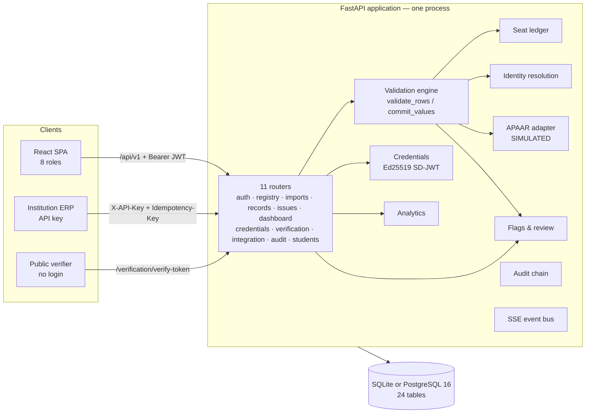
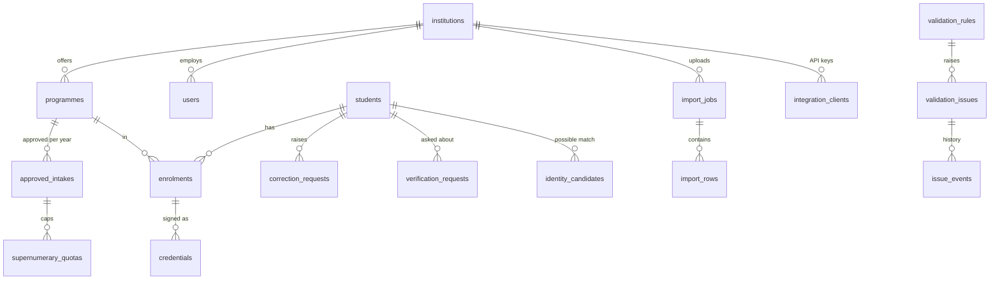
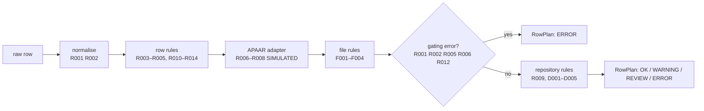
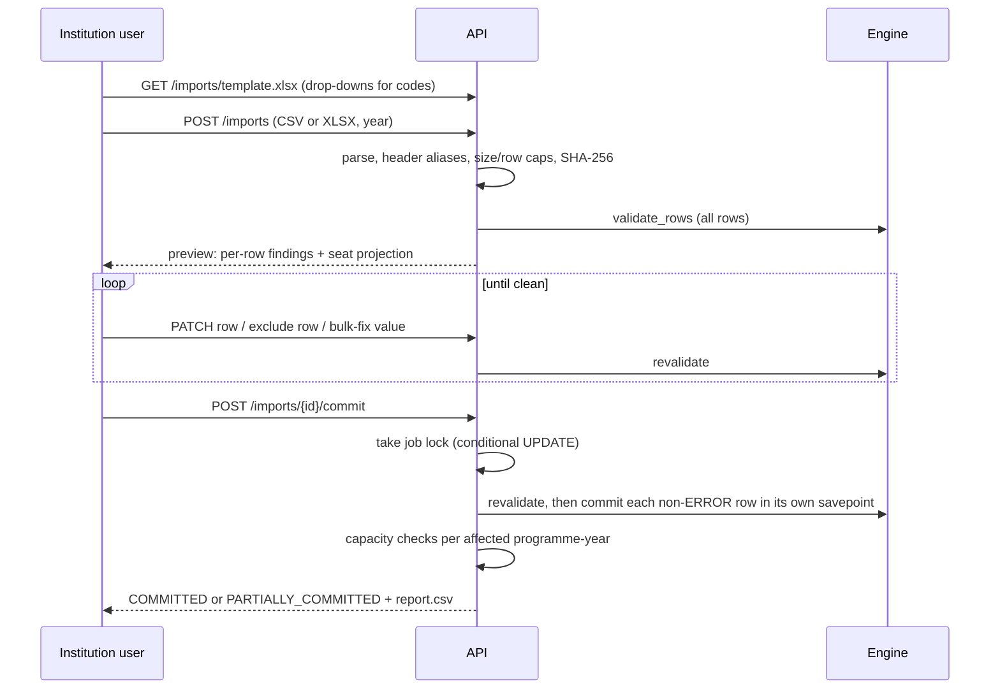

# APAAR Student Register: architecture, as built

This document explains **every part of the system as it exists in the code** (branch `claude/busy-newton-qnsfmy`, Oct 2026). For each part it covers:
- what it is for;
- how it works;
- where it lives;
- what is done and what is not.

**Related documents:**
- The target design is the v3 blueprint PDF.
- The gap between the two is in [`architecture-audit/`](architecture-audit/01-executive-assessment.md).

**Status labels used throughout:**

| Label | Meaning |
|---|---|
| **BUILT** | Implemented, tested, used in the demos |
| **PARTIAL** | Works but incomplete (the gap is stated) |
| **SIMULATED** | Stands in for an external system we have no access to |
| **NOT BUILT** | Designed (v3 or audit) but not in the code |

**All data is synthetic.** The APAAR registry check is SIMULATED, because no official APAAR verification API was available to us.

---

## Contents

1. [What the system does](#1-what-the-system-does)
2. [The big picture](#2-the-big-picture)
3. [Repository layout](#3-repository-layout)
4. [Runtime and configuration](#4-runtime-and-configuration)
5. [Data model](#5-data-model)
6. [Users, roles and security](#6-users-roles-and-security)
7. [The validation engine (core)](#7-the-validation-engine-core)
8. [Rule catalogue (26 rules)](#8-rule-catalogue-26-rules)
9. [Bulk import pipeline](#9-bulk-import-pipeline)
10. [Seat ledger and excess-intake detection](#10-seat-ledger-and-excess-intake-detection)
11. [Identity resolution (duplicate people)](#11-identity-resolution-duplicate-people)
12. [APAAR registry adapter (SIMULATED)](#12-apaar-registry-adapter-simulated)
13. [Flags, review workflow and redaction](#13-flags-review-workflow-and-redaction)
14. [Records, corrections and history](#14-records-corrections-and-history)
15. [Signed enrolment records (SD-JWT credentials)](#15-signed-enrolment-records-sd-jwt-credentials)
16. [Verification and consent](#16-verification-and-consent)
17. [Student self-service](#17-student-self-service)
18. [Dashboards, review priority and reports](#18-dashboards-review-priority-and-reports)
19. [ERP integration API](#19-erp-integration-api)
20. [Audit trail](#20-audit-trail)
21. [Live updates and notifications](#21-live-updates-and-notifications)
22. [Frontend](#22-frontend)
23. [Synthetic seed data and demos](#23-synthetic-seed-data-and-demos)
24. [Testing and quality gates](#24-testing-and-quality-gates)
25. [Deployment](#25-deployment)
26. [Complete API reference](#26-complete-api-reference)
27. [What is not built](#27-what-is-not-built)

---

## 1. What the system does

AICTE approves a fixed **intake** (number of seats) for every programme at every institution, each academic year. Today AICTE sees only declared totals, so three problems are hard to detect:

| Problem | How the system addresses it |
|---|---|
| **Excess admission:** more students admitted than approved | Every enrolment is a named record. Seats are counted from records, per seat category, against the approved intake and supernumerary caps. A **seat check** lets an admission desk ask before admitting. |
| **Duplicate students:** the same person enrolled at two institutions, or entered twice under different IDs | APAAR-ID cross-institution checks (D003), plus Indian-name-aware fuzzy identity matching (D005). Nothing is merged automatically. |
| **Unverifiable enrolment claims** to employers and others | Institutions issue **signed, selectively disclosable enrolment records** (SD-JWT). Anyone can verify the signature. Verifiers can also request a check that needs the student's consent. |

Everything else (dashboards, review priority, audit, corrections) supports these three.

## 2. The big picture



**Architectural style:** a **modular monolith**.
- One deployable FastAPI process serves both the JSON API and the built React app.
- Business logic lives in `backend/app/modules/`, one file per concern.
- **The one hard rule is that only the validation engine writes students and enrolments.** Upload, manual entry, corrections and the ERP API all go through it, so every path applies the same 26 rules.

**Size at audit time:**

| Part | Lines | Detail |
|---|---|---|
| Backend | 6,752 | 24 Python modules |
| Frontend | 2,633 | TS/TSX |
| Tests | 1,395 | |

The API has 70 endpoints plus 3 framework routes (docs, OpenAPI, SPA fallback).

## 3. Repository layout

```
backend/app/
  main.py            FastAPI app, router wiring, error shape, security headers, SPA serving
  config.py          Settings from environment; secret resolution
  db.py              Engine, sessions, UTC datetimes, post-commit hooks
  models.py          24 SQLAlchemy tables
  security.py        Passwords, JWT, roles, API keys, masking, rate limiter, ApiError
  audit.py           Hash-chained audit log
  secret_store.py    Server-generated secrets kept in Postgres (serverless)
  csvout.py          CSV export with formula-injection protection
  seed.py            Deterministic synthetic dataset + sample upload files
  modules/
    engine.py        Validation engine (only writer of students/enrolments)
    rules.py         Rule catalogue, severities, toggles
    normalize.py     Header aliases, value parsing, name keys, code lists
    intake.py        Upload parse → preview → correct → commit
    ledger.py        Seat counting, caps, status transitions, seat check
    identity.py      Fuzzy identity matching
    apaar_adapter.py SIMULATED registry + "did you mean"
    issues.py        Flags: open/dedupe, actions, capacity checks, redaction
    credentials.py   SD-JWT issue / present / verify / tamper demo
    analytics.py     Dashboards, review priority, report rows
    views.py         Role-aware serialisation (APAAR masking)
    events.py        In-process SSE bus
    api_*.py         11 HTTP routers (one per area)
backend/tests/       pytest suite (110 test functions, 128 cases)
frontend/src/        React 18 + TypeScript SPA (22 pages)
api/index.py         Vercel serverless entry
scripts/             run_demos.py, ui_tour.py, vercel_build.sh
sample_data/         Generated demo upload files
docs/                Design, API, traceability, test report, audit
```

## 4. Runtime and configuration

**Status: BUILT**

| Concern | How it works | File |
|---|---|---|
| Startup | `lifespan` creates tables (`create_all`), seeds the rule catalogue and loads or creates the issuer signing key | `main.py` L39 |
| Database | `DATABASE_URL`, else a SQLite file in `var/`. Both SQLite and PostgreSQL 16 are tested | `config.py` L35 |
| Settings | Environment variables with safe defaults (table below) | `config.py` L51 |
| Secrets | Resolved in order: environment variable → `app_secrets` table (Postgres only, so serverless instances share them) → file in `var/`. Covers the JWT secret, the APAAR HMAC key and the Ed25519 issuer key | `config.py` L72, `secret_store.py` |
| Time | All datetimes stored as UTC (`UTCDateTime` type) | `db.py` L28 |
| Errors | One JSON shape `{message, ...}`; no stack traces; unhandled errors logged with a request id | `main.py` L64–108 |
| Security headers | CSP (`default-src 'self'`, `frame-ancestors 'none'`), `nosniff`, `X-Frame-Options: DENY`, `Referrer-Policy: no-referrer`, `Cache-Control: no-store` on API, `X-Request-ID` | `main.py` L111–131 |
| Static frontend | Serves `frontend/dist`; unknown non-API paths return `index.html` (path-traversal checked) | `main.py` L141 |

**Main settings:**

| Setting | Default |
|---|---|
| Token lifetime | 120 min |
| Max upload | 2 MB / 5,000 rows (`MAX_UPLOAD_ROWS`; 1,000 on Vercel) |
| `DEMO_MODE` | `0`; `1` lists demo accounts on the login page |
| Current year | `2026-27` |
| Deadline | `2026-11-30` |
| Login rate | 30/min per IP |
| Verify rate | 60/min per IP |
| Lockout | 5 failures → 15 min |
| `APAAR_ADAPTER_MODE` | `simulated` or `unavailable` (to demo the R008 path) |
| `LIVE_EVENTS` | On locally, off on Vercel |

**Not done:**
- Migrations: the schema comes from `create_all`.
- Structured logging.
- Metrics.
- HSTS.

## 5. Data model

**Status: BUILT** (24 tables, `models.py`)



| Table | Purpose |
|---|---|
| `institutions` | AICTE code, name, state, region, type (ENGINEERING / MANAGEMENT / PGDM …) |
| `users` | Email, PBKDF2 password hash, role, institution, failed-login counter, lock time; students link to a `students` row |
| `programmes` | Programme code, name, level (DIPLOMA/UG/PG), discipline, per institution |
| `approved_intakes` | Approved seats per programme per academic year; submission-declared flag |
| `supernumerary_quotas` | Cap per supernumerary category per intake, with its **rule source** text (e.g. "DEFAULT: TFW up to 5%") |
| `students` | The person: APAAR ID (unique, nullable), name, normalised `name_key`, DOB, gender, nationality, citizenship, APAAR status (VERIFIED / UNVERIFIED / PENDING / MISMATCH), version |
| `enrolments` | A student in a programme-year: roll number, seat category, admission date, status (PROVISIONAL / ACTIVE / WITHDRAWN / TRANSFERRED_OUT / GRADUATED / CANCELLED), source, version |
| `import_jobs` | One upload: file name, SHA-256, year, status (PREVIEW / COMMITTING / PARTIALLY_COMMITTED / COMMITTED / DISCARDED), counts |
| `import_rows` | Each uploaded row: data, findings, status, link to the created enrolment |
| `validation_rules` | The 26 rules: severity, stage, enabled, locked, remediation text |
| `validation_issues` | **Flags**: rule, subject, institution, year, evidence, status, assignee |
| `issue_events` | Every action on a flag (who, role, action, note) |
| `record_revisions` | Before/after field changes for students and enrolments, with reason and actor |
| `audit_events` | Hash-chained audit log |
| `credentials` | Issued signed records: token, key id, status (ACTIVE/REVOKED), validity |
| `verification_requests` | Verifier → student consent requests |
| `correction_requests` | Student → institution correction requests |
| `identity_candidates` | Possible same-person pairs with score and reasons; reviewer decision |
| `seat_check_logs` | Every seat-check question and answer |
| `integration_clients` | ERP API keys (SHA-256 hash, prefix, scopes, active) |
| `idempotency_records` | ERP push idempotency (key → stored response) |
| `notifications` | In-app notifications per user/institution |
| `sim_apaar_registry` | **SIMULATED** APAAR registry (synthetic IDs, names, DOBs) |
| `app_secrets` | Server-generated secrets (Postgres deployments only) |

## 6. Users, roles and security

**Status: BUILT, with gaps listed below.**

### Roles (`security.py` L26)

| Role | Who | Can |
|---|---|---|
| `AICTE_ADMIN` | AICTE administrator | Everything AICTE: set intake/caps, toggle rules, decide identity matches, review flags, see audit |
| `AICTE_ANALYST` | AICTE monitoring officer | National dashboards, review queue, flags. APAAR IDs are masked even for this role |
| `INST_ADMIN` | Institution nodal officer | Everything an institution can do, plus declare submission, issue/revoke records, manage API keys |
| `INST_STAFF` | Data-entry operator | Upload, correct, add students, resolve own flags, handle correction requests |
| `VERIFIER` | Employer / university | Request consent-based verification |
| `AUDITOR` | Auditor | Audit trail, chain verification, flags (read), integration status |
| `STUDENT` | Student | Own record, share signed records, answer consent requests, request corrections |
| *(anonymous)* | Anyone | Verify a shared token; check credential status |

### Mechanisms

| Mechanism | How | File |
|---|---|---|
| Passwords | Salted PBKDF2-SHA256, 210,000 iterations | `security.py` L45 |
| Sessions | HS256 JWT (purpose-tagged), 120 min, sent as `Bearer`; the SPA keeps it in sessionStorage | `security.py` L65, `frontend/src/api.ts` |
| Login protection | Per-IP rate limit (30/min); per-account lockout after 5 failures (15 min); every failure audited | `api_auth.py` L49 |
| Role checks | `require_roles(...)` FastAPI dependency on every protected route | `security.py` L189 |
| Institution scoping | `ensure_institution(actor, id)`; queries filter by the actor's institution | `security.py` L203, routers |
| API keys | Random key shown once; only its SHA-256 is stored; constant-time compare; scopes `enrolments:write`, `seat:check` | `security.py` L129–150 |
| APAAR masking | The full ID is shown only to the owning institution and the student; others see `XXXX XXXX 1234`; an HMAC reference is used where linking is needed | `views.py`, `security.py` L212 |
| Denied access | 403s are written to the audit log | `main.py` L70 |
| CSV safety | Cells starting with `= + - @` are neutralised | `csvout.py` |

**Known gaps** (details in [audit doc 07](architecture-audit/07-security-and-privacy-assessment.md)):
- ~~The login response time reveals whether an email exists.~~ Fixed: unknown emails also run a password hash.
- ~~`/auth/demo-accounts` is public.~~ Fixed: served only when `DEMO_MODE=1`.
- The rate limiter is in memory.
- Tokens can't be revoked before expiry.
- There is no MFA.
- The XLSX parser isn't protected against zip/XML bombs.

## 7. The validation engine (core)

**Status: BUILT** (`modules/engine.py`)

This is the heart of the system. **Four entry points call it, and nothing else writes `students` or `enrolments`:**
- bulk upload;
- manual "add student";
- record corrections;
- the ERP push API.



**Steps:**
1. **`validate_rows(db, rows, institution, year, …)`** runs the pipeline above for a batch of rows and returns a `RowPlan` for each: normalised values, findings, overall status, and the matched existing student or enrolment.
   - Registry lookups are batched (500 IDs per query).
   - Repository rules are skipped when a gating error makes them meaningless.
2. **Severity decides what happens:**

   | Severity | Effect |
   |---|---|
   | ERROR | The row cannot be committed |
   | REVIEW | The row is committed **and** a flag opens for a person to look at |
   | WARNING | Shown, no flag |

3. **`commit_values(db, plan, …)`** writes the row:
   - creates or updates the `Student` (master data is never silently overwritten; conflicts raise D004 instead);
   - creates or updates the `Enrolment`;
   - writes `record_revisions` with before/after values and a reason;
   - opens REVIEW flags;
   - buffers an audit event.
4. **Projection.** Callers add the seat-ledger "what happens if you commit this" view (section 10).

**Not done:**
- Rule *sets* with versions and effective dates (v3).
- Per-row repository queries aren't batched; this is the main cost in a large commit.

## 8. Rule catalogue (26 rules)

**Status: BUILT** (`modules/rules.py`)

Every rule has a stable ID, a severity, a stage, a description and **remediation text telling the user what to do**. AICTE admins can toggle each rule or change its severity on the Rules page, except **locked** rules, which protect data integrity.

| Stage | Rule | Severity | Meaning |
|---|---|---|---|
| ROW | R001_REQUIRED 🔒 | ERROR | Required column empty |
| ROW | R002_FORMAT 🔒 | ERROR | Bad date, code, email or year format |
| ROW | R003_APAAR_MISSING | ERROR | No APAAR ID and no pending reason |
| ROW | R004_APAAR_PENDING | REVIEW | No APAAR ID, documented reason given |
| ROW | R005_APAAR_FORMAT | ERROR | Not 12 digits, or one repeated digit |
| ADAPTER | R006_APAAR_NOT_FOUND | ERROR | Not in the (SIMULATED) registry; may suggest "did you mean" |
| ADAPTER | R007_APAAR_MISMATCH | REVIEW | Registry name/DOB differs |
| ADAPTER | R008_APAAR_UNVERIFIED | WARNING | Registry unavailable; stored UNVERIFIED |
| REPOSITORY | R009_DUPLICATE_ENROLMENT | ERROR | Same student already in this programme-year under another roll number |
| ROW | R010_DATE_LOGIC | ERROR | Future date, or age at admission under 15 |
| ROW | R011_DATE_UNUSUAL | WARNING | Age over 45, or admission outside 1 May–31 Mar |
| ROW | R012_PROGRAMME | ERROR | Programme not approved for this institution/year |
| ROW | R013_CATEGORY_CONSISTENCY | ERROR | Seat category conflicts with nationality (e.g. NRI seat for a foreign national) |
| ROW | R014_YEAR_MISMATCH | ERROR | Row year differs from the upload year |
| ROW | R015_MINOR_GUARDIAN_CONSENT | REVIEW | Student under 18 today without recorded guardian consent. Sharing and consent-based verification are held (409) until the institution records it |
| FILE | F001_DUP_APAAR_IN_FILE 🔒 | ERROR | Same APAAR ID twice in one file |
| FILE | F002_DUP_ROLL_IN_FILE 🔒 | ERROR | Same roll number twice in one file |
| FILE | F003_POSSIBLE_DUP_IN_FILE | WARNING | Same name + DOB, different APAAR IDs |
| FILE | F004_REPEATED_FILE | WARNING | Identical file (SHA-256) uploaded before |
| REPOSITORY | D001_EXISTING_RECORD | WARNING | Will update an existing enrolment (history kept) |
| REPOSITORY | D002_ROLL_CONFLICT 🔒 | ERROR | Roll number belongs to a different student |
| REPOSITORY | D003_XINST_ACTIVE | REVIEW | **Active enrolment at another institution** |
| REPOSITORY | D004_ATTR_CONFLICT | REVIEW | Register holds this APAAR ID with a different name/DOB |
| REPOSITORY | D005_POSSIBLE_DUP_IDENTITY | REVIEW | Probably the same person under another/no APAAR ID |
| AGGREGATE | C001_EXCESS_INTAKE | REVIEW | REGULAR + NRI enrolments exceed approved intake |
| AGGREGATE | C002_SUPERNUMERARY_CAP | REVIEW | A supernumerary category exceeds its cap |

**Not done:** v3 numbers some rules differently from the code (see the audit).

## 9. Bulk import pipeline

**Status: BUILT** (`modules/intake.py`, `api_imports.py`, frontend `Upload.tsx`, `ImportDetail.tsx`)



**How it works:**
- **Parsing:**
  - CSV (UTF-8 with or without BOM) and XLSX via openpyxl.
  - Headers are matched through aliases, so "Roll No", "Student ID" and others all map to `institution_student_id`.
  - Limits: 2 MB and 5,000 rows.
- **Template:** 14 columns (`normalize.TEMPLATE_COLUMNS`); the XLSX template has drop-down lists for code columns.
- **Preview:**
  - Every row shows its status and findings with the remediation text.
  - The **projection** shows each programme's seat position *if* the upload is committed (e.g. "62 / 60, 2 over intake").
- **Correction tools:**
  - Edit a single row.
  - Leave out a row, with a reason.
  - **Bulk fix:** replace one value with another across all rows, e.g. every "B.Tech CSE" → `BTECH-CSE`.
  - **Did-you-mean** for mistyped APAAR IDs.
- **Commit is safe to retry:**
  - A conditional `UPDATE … WHERE status IN (PREVIEW, PARTIALLY_COMMITTED)` acts as a lock, so a double click can't commit twice. A lock older than 10 minutes counts as stale.
  - Each row commits in a savepoint, so one bad row never loses the others; the upload becomes PARTIALLY_COMMITTED and can be retried.
  - Re-committing updates records rather than duplicating them.
- **Report:** `report.csv` has every row with its final status and findings.

**Measured** (5,000 valid rows):

| Step | SQLite | PostgreSQL |
|---|---|---|
| Preview | 5.7 s | 11.9 s |
| Commit | 23.2 s | 48.8 s |

**Upload hardening:** before openpyxl opens a workbook, the zip is rejected if it unpacks to more than 50 MB or more than 100× its compressed size, or if any XML part declares a `DOCTYPE`. Rows are read one at a time and reading stops as soon as the row limit is passed.

**Not done:** background processing. Commit runs inside the HTTP request, which is why Vercel caps uploads at 1,000 rows.

## 10. Seat ledger and excess-intake detection

**Status: BUILT** (`modules/ledger.py`, `issues.run_capacity_checks`, `SeatCheck.tsx`, `SeatStrip.tsx`)

**Rules (the definition of "excess"):**
1. Only **ACTIVE** and **PROVISIONAL** enrolments occupy a seat.
2. **REGULAR + NRI** seats count against the approved intake.
3. Each **supernumerary** category (`SN_FN_OCI`, `SN_CIWG`, `SN_TFW`, `SN_OTHER`) counts only against its own cap. Unused supernumerary seats are not transferable.
4. `excess_over_intake = max(0, REGULAR + NRI − intake)`; category excess is `max(0, enrolled − cap)`.

**Counts are computed with `COUNT(*)` from enrolments every time.** There is no stored counter that could drift.

**Default caps.** These apply when AICTE hasn't set a cap; values are rounded down and each stores its rule source:

| Category | Default cap |
|---|---|
| FN/OCI/CIWG pool | 15% of intake for engineering diploma/UG, otherwise 25% |
| `SN_CIWG` | One third of the pool |
| `SN_FN_OCI` | The remaining two thirds of the pool |
| `SN_TFW` | 5% of intake |
| `SN_OTHER` | 0 |

AICTE can override any cap on the Intake page.

**Status transitions** are enforced:
- PROVISIONAL → ACTIVE / CANCELLED / WITHDRAWN
- ACTIVE → WITHDRAWN / TRANSFERRED_OUT / GRADUATED / CANCELLED
- WITHDRAWN → ACTIVE

**Capacity flags.** After every commit or status change, `run_capacity_checks` opens or updates **C001** (over intake) or **C002** (over a cap). If the condition disappears, for example after a cancellation, the flag closes automatically as a SYSTEM event and can be reopened.

**Seat check (prevention, not just detection):**
- `POST /seat-check {programme, category, count}` answers "would admitting N more exceed the limit?" *before* admission.
- It is available to institution users and to ERPs through the `seat:check` API scope.
- Every question is logged in `seat_check_logs`.

**Concurrency:** `run_capacity_checks` locks the programme-year's `approved_intakes` row (`SELECT … FOR UPDATE`) before counting. A second commit for the same programme waits, then counts the first one's rows, so two admissions for the last seat cannot both miss the C001 flag. Tested on PostgreSQL (`test_concurrent_commits_cannot_miss_excess_flag`); SQLite serialises writers anyway.

## 11. Identity resolution (duplicate people)

**Status: BUILT** for online scoring; batch matching is NOT BUILT (`modules/identity.py`, `Identity.tsx`)

**Purpose:** find the same person entered twice, either with no APAAR ID, a different one, or a typo. These cases are invisible to an exact-ID check.

**How it works:**
- **Blocking:** candidates are existing students with the same DOB, or with the day and month swapped.
- **Indian-name normalisation:**
  - Phonetic folding (aa→a, ee→i, th→t, bh→b, …).
  - Jaro–Winkler similarity ≥ 0.92.
  - Initials match full names ("K." ↔ "Kumar").
  - Token order is ignored.
- **Scoring:** Fellegi–Sunter-style weights, each recorded so reviewers see *why* two records match:

  | Signal | Weight |
  |---|---|
  | Exact name tokens | +6 |
  | All tokens equivalent | +4.5 |
  | Initial-compatible | +3 |
  | Partial overlap | +2 per shared token |
  | DOB exact | +4 |
  | DOB day/month swapped | +1.5 |
  | Gender agrees / disagrees | +1 / −3 |
  | Different APAAR IDs | −2 |
  | Linked by a recorded transfer | −2 |

- **Outcomes:**

  | Score | Result |
  |---|---|
  | ≥ 9 | **D005 REVIEW flag** |
  | 6–9 | Listed as a candidate only |

  **Nothing is ever merged automatically.** An AICTE admin marks a pair SAME or DIFFERENT, and a DIFFERENT decision stops the pair being flagged again.

**Not done:**
- A labelled test set with precision/recall.
- Batch (nightly) matching.
- Non-Latin script names.
- A cap on large same-DOB blocks.

## 12. APAAR registry adapter (SIMULATED)

**Status: SIMULATED** (`modules/apaar_adapter.py`)

No official APAAR verification API contract was available, so the adapter reads a synthetic `sim_apaar_registry` table. Every result is labelled `mode="SIMULATED"`, and the UI shows that label wherever an APAAR check appears.

| Function | What it does |
|---|---|
| `lookup_many` | Batched lookup (500 IDs per query) |
| `check` | FOUND / NOT_FOUND / INACTIVE / MISMATCH (name or DOB) / UNAVAILABLE |
| `did_you_mean` | Tries all 108 single-digit substitutions and up to 11 adjacent swaps of a mistyped ID. Suggests one **only if** exactly one variant's registry name and DOB match the row |
| `set_adapter` | Lets tests or a future live adapter replace it; `APAAR_ADAPTER_MODE=unavailable` simulates an outage (R008) |

A live adapter would implement the same interface. That requires MoE/ABC agreement; nothing here assumes the API exists.

## 13. Flags, review workflow and redaction

**Status: BUILT** (`modules/issues.py`, `api_issues.py`, `Issues.tsx`)

**A flag means "a person should look". It is never labelled fraud.**

- **Opening:**
  - `open_or_update` creates a flag, or updates the open one for the same rule and subject, so re-uploads don't create duplicates.
  - The responsible institution is notified.
- **Workflow:**

  ```mermaid
  stateDiagram-v2
    [*] --> OPEN
    OPEN --> CLARIFICATION_REQUESTED: AICTE asks
    CLARIFICATION_REQUESTED --> RESPONDED: institution replies
    RESPONDED --> CLARIFICATION_REQUESTED
    OPEN --> RESOLVED
    RESPONDED --> RESOLVED
    OPEN --> DISMISSED
    RESOLVED --> OPEN: reopen
    DISMISSED --> OPEN: reopen
  ```

  `allowed_actions` returns only what the viewer's role may do. Every action is recorded in `issue_events` with actor, role and note, and appears in the history.
- **Privacy-preserving redaction (D003):** an institution sees "Another AICTE-approved institution (identity withheld)" rather than the other institution's name. Only AICTE sees both sides.
- **Export:** a filtered CSV.

**Not done:**
- Structured explanation objects.
- Resolution outcome codes (e.g. false positive).
- Assignment and SLA.
- A unique index preventing duplicate flags under concurrency.

## 14. Records, corrections and history

**Status: BUILT** (`api_records.py`, `Records.tsx`, `RecordDetail.tsx`, `AddStudent.tsx`, `Corrections.tsx`)

| Feature | How |
|---|---|
| Search | By name, APAAR, roll number, programme, status, year; sortable; scoped by role |
| Manual entry | The same engine as upload. REVIEW findings need an explicit "acknowledge" |
| Corrections | `PATCH /enrolments/{id}` re-runs validation. Master fields (name, DOB, gender, nationality, citizenship, APAAR) are versioned on the student; enrolment fields on the enrolment. A reason is required |
| Status change | Transition rules enforced (section 10). Triggers capacity re-checks |
| History | `record_revisions` shows every before/after with who, when and why. APAAR values are masked for viewers who can't see them |
| Student correction requests | Students request a change to their own record; the institution accepts (applied through the engine) or rejects with a note |

## 15. Signed enrolment records (SD-JWT credentials)

**Status: BUILT** (`modules/credentials.py`, `api_credentials.py`)

An institution admin issues a **signed enrolment record** that a student can share, revealing only the fields they choose.

- **Format:** an SD-JWT (RFC 9901 style) with a W3C VC 2.0-shaped payload, signed with **Ed25519**.

  ```
  <header>.<payload>.<signature>~<disclosure>~<disclosure>~…~
  ```

  Each disclosure is `base64url([salt, claim, value])`. The signed payload carries only `credentialSubject._sd = [sha256(disclosure), …]`. The verifier checks each revealed value against a signed digest, and unrevealed values can't be recovered.
- **Claims** (`CLAIMS`): APAAR ID, name, institution student ID, institution, AICTE institution code, programme, admission year, enrolment status.
- **Validity:** 365 days.
- **Revocation:** an institution or AICTE admin revokes a record with a reason; verification then fails the status check.
- **Issuer key:**
  - Ed25519, with its public key published at `/.well-known/issuer-keys` as a JWKS with a key id.
  - Stored in an environment variable, `app_secrets` or `var/`.
- **Outputs:**
  - Printable certificate page.
  - QR code (SVG) that links to verification.
- **Tamper demo:** `/verification/tamper-demo` alters a token without re-signing it: either a disclosed value (e.g. status changed to GRADUATED) or the signed payload (validity extended to 2099). Verification catches both.

**Not done:**
- `vct` / SD-JWT VC typing.
- A key registry with rotation.
- Status lists.
- Short revocable share codes; today the QR carries the token or the credential id.

## 16. Verification and consent

**Status: BUILT** (`api_verification.py`, `Verify.tsx`, `VerifierRequests.tsx`)

There are two ways to verify.

**A. Token verification (public, no login).** Paste or scan a shared token. Six checks run in order; if one fails, the later ones are skipped:

| # | Check | What it confirms |
|---|---|---|
| 1 | Structure | Well-formed SD-JWT |
| 2 | Known issuer key | The `kid` matches the published key |
| 3 | Signature | Ed25519 signature valid |
| 4 | Disclosures | Every revealed value matches a signed digest |
| 5 | Validity period | Not expired or not yet valid |
| 6 | Revocation status | Credential is still ACTIVE |

Each check returns a plain-English sentence. Rate limit: 60/min per IP.

**B. Consent-based request (logged-in verifier).**
1. The verifier enters the student's details and a purpose.
2. The response is **always the same** ("If the details match, the student will be asked for consent"), so the endpoint can't be used to discover whether someone is enrolled.
3. If the details match, the student sees the request and approves or declines it.
4. If approved, the verifier sees the agreed fields: name, masked APAAR ID, institutions, programmes, years, statuses.
5. Verifiers are limited to 30 requests per hour.

Approving a request for a student under 18 is held until the institution records guardian consent (R015).

**Not done:**
- Consent revocation.
- Verifier organisation approval.
- A student-visible access log.

## 17. Student self-service

**Status: BUILT** (`api_students.py`, `MyRecord.tsx`)

- See their own record: all enrolments, APAAR status and history.
- **Share:** tick the fields to reveal, then get a presentation token and QR code (`POST /me/credentials/{id}/present`).
- Answer verifier consent requests.
- Raise and track correction requests.

**Not done:** OTP or DigiLocker login. Demo students log in with a password.

## 18. Dashboards, review priority and reports

**Status: BUILT** (`modules/analytics.py`, `api_dashboard.py`, `National.tsx`, `InstDashboard.tsx`, `ReviewPriority.tsx`, `Reports.tsx`)

**Every number is computed from the database at request time.**

| View | Who | Shows |
|---|---|---|
| National dashboard | AICTE | Totals, over-intake programmes with seat strips, by state and discipline, nationality mix, open flags, trends against last year |
| Institution dashboard | Institution | Its programmes' seat strips, open flags, uploads, correction requests, deadline, declare submission |
| Review priority | AICTE | Institutions ranked for review attention, with the reason for every point |
| Reports (CSV) | Scoped by role | Intake utilisation, nationality, review priority |

**Review priority scoring.** It is transparent and capped at 100. The output always carries the disclaimer: **"A high score is not evidence of wrongdoing."**

| Signal | Points |
|---|---|
| Seats over intake | up to 35 |
| Supernumerary over cap | up to 15 |
| Open cross-institution flags | up to 20 |
| Unverified APAAR share > 5% | up to 15 |
| Uncorrected upload errors > 10% | up to 10 |
| Enrolment jump > 30% with no intake change | 10 |
| Changes after declaring submission | up to 10 |
| Overdue student corrections | up to 10 |
| Peer outlier (robust z > 3.5 on 5 metrics) | +8 each |

Bands: LOW < 25, MEDIUM 25–49, HIGH ≥ 50.

**Not done:**
- Forecasting.
- Completeness tracker.
- AISHE export.
- Reconciliation with declared totals.

## 19. ERP integration API

**Status: BUILT** (`api_integration.py`, `SystemAccess.tsx`, `Integrations.tsx`)

- **API keys:**
  - An institution admin creates a key with scopes (`enrolments:write`, `seat:check`); the full key is shown once.
  - The key can be revoked.
- **Push:**
  - `POST /integration/enrolments` with `X-API-Key` and a required `Idempotency-Key`.
  - Rows go through the same engine.
  - Repeating a request with the same key returns the stored response instead of writing again.
- **Status page:** `GET /integration/status` lists each external integration and its mode, e.g. APAAR = SIMULATED, DigiLocker = NOT_IMPLEMENTED.

**Not done:**
- Webhooks or outbound events.
- An expiry for idempotency records.

## 20. Audit trail

**Status: BUILT, with a known weakness** (`audit.py`, `api_audit.py`, `Audit.tsx`)

- **What is logged:** every significant action, including logins (success and failure), uploads, commits, corrections, status changes, flag actions, credential issue/revoke, verifications, rule and intake changes, and denied (403) requests.
- **Tamper evidence:**
  - Each event stores `hash = sha256(prev_hash + canonical_json(event))`, starting from a genesis hash of 64 zeros.
  - `verify-chain` recomputes the chain and reports the first broken link.
- **Privacy:**
  - `scrub()` removes sensitive keys (`apaar_id`, `password`, `token`, `api_key`).
  - Any 12-digit number is masked.
  - Student names are never written to audit details.
- **Ordering:**
  - Events are buffered during the request.
  - After the business transaction commits, they are appended in a short separate transaction, under a process lock plus a PostgreSQL advisory lock, so the chain stays linear across instances.
  - Denied or failed actions are written even if the business transaction rolled back.
- **Viewing:** filter by action, outcome, role and entity; CSV export. AUDITOR and AICTE_ADMIN only.

**Weaknesses:**
- Because the append happens *after* commit, a crash in between loses the event.
- Deleting the newest events leaves a valid-looking chain.

The fix (same-transaction writes plus signed checkpoints) is in audit docs 07 and 08.

## 21. Live updates and notifications

**Status: BUILT locally; PARTIAL on serverless** (`modules/events.py`, `api_registry.py /events`)

- **Live events:**
  - An in-process Server-Sent Events bus.
  - Events are published only after their transaction commits.
  - Institution users receive events about their own institution; AICTE roles receive all.
  - The browser gets a 2-minute stream token (`/auth/stream-token`) because EventSource can't send headers.
- **On Vercel** (serverless, no long-lived process), `LIVE_EVENTS` is off and the UI polls every 30 seconds instead.
- **Notifications:** a `notifications` table feeds the "Updates" panel, e.g. a flag opened for your institution, or a correction request.

**Not done:**
- Cross-instance fan-out.
- Email/SMS.

## 22. Frontend

**Status: BUILT** (`frontend/src/`, React 18.3 + TypeScript 5.6 + Vite 5, hash routing)

**Design:**
- Official-government-portal look: a header band, sticky navigation, and accessible type (self-hosted Atkinson Hyperlegible, IBM Plex Mono).
- Text-size control.
- Responsive down to 390 px with no horizontal page scroll.
- No official logos or emblems are used.

| Route | Page | Roles |
|---|---|---|
| `/login` | Sign in (demo accounts listed) | all |
| `/verify` | Public verification + tamper demo | anyone |
| `/inst` | Institution dashboard | INST_* |
| `/inst/upload`, `/inst/imports/:id` | Upload and preview/correct/commit | INST_* |
| `/inst/add` | Add one student | INST_* |
| `/inst/system-access` | API keys | INST_ADMIN |
| `/seat-check` | Seat check | INST_* |
| `/corrections` | Student correction queue | INST_* |
| `/records`, `/records/:id` | Search, detail, history, credentials | INST_*, AICTE_* |
| `/issues`, `/issues/:id` | Flags and review actions | INST_*, AICTE_*, AUDITOR |
| `/reports` | CSV reports | INST_*, AICTE_* |
| `/aicte` | National dashboard | AICTE_* |
| `/aicte/priority` | Review priority | AICTE_* |
| `/aicte/identity` | Identity candidates | AICTE_* |
| `/aicte/rules` | Rule toggles | AICTE_* (edit: admin) |
| `/aicte/intakes` | Intake and caps | AICTE_ADMIN |
| `/aicte/integrations` | Integration status | AICTE_*, AUDITOR |
| `/audit` | Audit trail | AUDITOR, AICTE_ADMIN |
| `/verifier/requests` | Consent requests | VERIFIER |
| `/me` | My record, share, consent, corrections | STUDENT |

**Shared pieces:**
- `api.ts`: fetch wrapper, token, errors.
- `components/ui.tsx`: badges, tables, banners, toasts.
- `SeatStrip.tsx`: an SVG seat bar per programme with an `aria-label` giving the counts.
- `Guard` in `App.tsx`: role-based route protection. **The server still enforces every permission; the guard only hides pages.**

**Not done:**
- A generated typed API client (pages use `any`).
- Hindi labels.
- An automated accessibility (axe) check.

## 23. Synthetic seed data and demos

**Status: BUILT** (`seed.py`, `scripts/run_demos.py`)

**Seed.** `python -m app.seed --reset` builds a deterministic dataset. Seed rows go **through the real import path**, so their flags, revisions and audit events are genuine. It contains:

- **5 synthetic institutions** in Tamil Nadu, Telangana, Maharashtra, Delhi and Karnataka:
  - Kaveri Institute of Technology
  - Godavari Engineering College
  - Narmada School of Management
  - Yamuna Institute of Management (PGDM)
  - Brahmaputra Polytechnic & Engineering
- 12 programmes with approved intakes for 2025-26 and 2026-27. Narmada MBA is deliberately over intake: 64 / 60.
- Students with Indian and foreign names, NRI/OCI/CIWG/TFW seats, and a synthetic APAAR registry.
- One login per role. The password is `Demo@2026`, for demo only.
- Sample upload files in `sample_data/`.

**Demos (`make demos`)** run 29 automated checks against a live server:

| Demo | Story |
|---|---|
| **A: Excess intake** | Kaveri uploads a file with typos, a wrong programme code and a duplicate. The user fixes them with guided messages, bulk fix and did-you-mean, and the preview shows the seat projection. Commit takes MBA over intake → C001 flag → AICTE sees it on the national dashboard |
| **B: Duplicate student** | Godavari enrols a student already active at Kaveri → D003 flag with Kaveri's identity withheld; a name-variant duplicate → D005 with match reasons → AICTE decides |
| **C: Verification** | Institution issues a signed record → student shares selected fields → employer verifies (6 checks pass) → tamper demo fails → revocation fails status → consent request flow |

## 24. Testing and quality gates

**Status: BUILT, with CI** (`.github/workflows/ci.yml`: ruff, pytest on SQLite and PostgreSQL 16, `scripts/check_claims.py`, frontend typecheck and build)

| Gate | Command | Result |
|---|---|---|
| Backend tests | `make test` (pytest, isolated temp DB) | **128 passed** on PostgreSQL 16; on SQLite 127 passed, 1 skipped (the PostgreSQL-only lock test) |
| Claims register | `python scripts/check_claims.py` | OK (36 entries) |
| Lint | `make lint` (ruff) | Pass |
| Types | `make typecheck` (tsc) | Pass |
| Demos | `make demos` | 29/29 checks pass; audit chain valid |
| UI tour | `make tour` (Playwright, 1360 px and 390 px) | 64 page views, 0 console errors, 0 overflow |

**Test files:**

| File | Cases | Covers |
|---|---|---|
| `test_rules.py` | 41 | Every rule, including R015 and its date boundaries |
| `test_ledger.py` | 21 | Seat maths, caps, transitions, concurrent capacity checks (PostgreSQL) |
| `test_security.py` | 14 | Roles, scoping, masking, lockout, login timing, `DEMO_MODE` |
| `test_platform.py` | 13 | Audit chain, events, integration, idempotency, row-cap config |
| `test_imports.py` | 12 | Upload, correct, partial commit, retry, zip/entity bombs, row cap |
| `test_credentials.py` | 10 | Issue, disclose, tamper, revoke, minor hold |
| `test_claims.py` | 5 | Claims checker and `/system/status` |
| `test_identity.py` | 6 | Name matching |
| `test_corrections.py` | 5 | Student correction flow |
| `test_demo_b.py` | 1 | Demo B end to end |

**Not done:** fuzz, generated cross-tenant and load tests.

## 25. Deployment

| Target | Files | Status |
|---|---|---|
| Local | `make setup && make seed && make run` → http://localhost:8000 | **BUILT**, used for all testing |
| Docker | `Dockerfile` (Node build stage, then Python 3.12 slim), `docker-compose.yml` | **PARTIAL**: written but not built in this environment (no Docker daemon). Note: the container command re-seeds with `--reset` on every start, which is demo-only behaviour |
| Vercel + Neon | `vercel.json`, `api/index.py`, `scripts/vercel_build.sh` | **PARTIAL**: config ready. Project `apaar-student-register` created; **not deployed**, because the Neon database is not yet attached |

**Vercel design:**
- The SPA is served as static files.
- `/api/*` and `/.well-known/*` are rewritten to one Python function (60 s maximum).
- The build seeds the database only if it is empty (`--if-empty`).
- Secrets are generated server-side into `app_secrets`.
- SSE is off, with 30-second polling instead.

**Not production-grade:**
- India-region hosting.
- Backups.
- Monitoring.

## 26. Complete API reference

All paths are under `/api/v1` unless shown otherwise. The interactive docs are at `/api/docs`.

| Area | Endpoints |
|---|---|
| **Auth** | `POST /auth/login` · `GET /auth/me` · `POST /auth/stream-token` · `GET /auth/demo-accounts` (only when `DEMO_MODE=1`) |
| **System** | `GET /system/status` (public feature-status register) |
| **Registry** | `GET /config` · `GET /institutions` · `GET /programmes` · `POST /intakes` · `PATCH /intakes/{id}/quotas/{category}` · `POST /intakes/{id}/submit` · `POST /seat-check` · `GET /events` (SSE) · `GET /rules` · `PATCH /rules/{rule_id}` · `GET /notifications` |
| **Imports** | `GET /imports/template.csv` · `GET /imports/template.xlsx` · `POST /imports` · `GET /imports` · `GET /imports/{id}` · `PATCH /imports/{id}/rows/{row}` · `POST /imports/{id}/rows/{row}/exclude` · `POST /imports/{id}/bulk-fix` · `POST /imports/{id}/commit` · `POST /imports/{id}/discard` · `GET /imports/{id}/report.csv` |
| **Records** | `GET /enrolments` · `POST /enrolments` · `GET /enrolments/{id}` · `PATCH /enrolments/{id}` · `POST /enrolments/{id}/status` · `GET /identity/candidates` · `POST /identity/candidates/{id}/decision` |
| **Flags** | `GET /issues` · `GET /issues/export.csv` · `GET /issues/{id}` · `POST /issues/{id}/actions` |
| **Dashboards** | `GET /dashboard/national` · `GET /dashboard/institution` · `GET /dashboard/review-priority` · `GET /reports/intake-utilisation.csv` · `GET /reports/nationality.csv` · `GET /reports/review-priority.csv` |
| **Credentials** | `POST /enrolments/{id}/credentials` · `GET /enrolments/{id}/credentials` · `POST /credentials/{id}/revoke` · `GET /credentials/{id}/qr.svg` · `GET /credentials/{id}/certificate` · `GET /.well-known/issuer-keys` |
| **Verification** | `POST /verification/verify-token` · `POST /verification/tamper-demo` · `GET /verification/credentials/{id}` · `POST /verification/requests` · `GET /verification/requests` · `POST /verification/requests/{id}/consent` · `GET /verification/requests/{id}/result` |
| **Students** | `GET /me/record` · `POST /me/credentials/{id}/present` · `GET /me/correction-requests` · `POST /me/correction-requests` · `GET /correction-requests` · `POST /correction-requests/{id}/actions` |
| **Integration** | `POST /integration/enrolments` · `GET /integration/status` · `GET /integration/clients` · `POST /integration/clients` · `POST /integration/clients/{id}/revoke` |
| **Audit** | `GET /audit` · `GET /audit/verify-chain` · `GET /audit/export.csv` |
| **Meta** | `GET /api/health` · `GET /api/docs` · `GET /api/openapi.json` |

More detail on request and response shapes: [`API_DESIGN.md`](API_DESIGN.md).

## 27. What is not built

Done since the audit: the claims register (`/#/status`), upload hardening, login timing and `DEMO_MODE`, the capacity-check lock, R015 and CI.

| Capability | Why it matters | Where planned |
|---|---|---|
| Database migrations (Alembic) | Safe schema changes | P0-7 |
| Same-transaction audit + signed checkpoints | No lost or truncated audit | P0-4, P1-8 |
| Background jobs + outbox + webhooks | Large commits, retries, integrations | P1-1, P2-8 |
| Share codes, key registry, status list | Revocable sharing, key rotation | P1-3, P1-9 |
| Versioned rule sets with impact preview | Safe rule changes mid-season | P1-10 |
| Golden set + batch identity matching | Measured accuracy | P1-12, P2-4 |
| Transfer workflow, reconciliation, AISHE export, forecasting | Higher-value features | P2 |
| Real APAAR / DigiLocker / AISHE / approval-portal integrations | Need government agreements | P3 (external) |
| India-region production hosting, VAPT, monitoring, backups | Required before real data | P3 |

The full prioritised plan is in [`architecture-audit/09-implementation-roadmap.md`](architecture-audit/09-implementation-roadmap.md).
