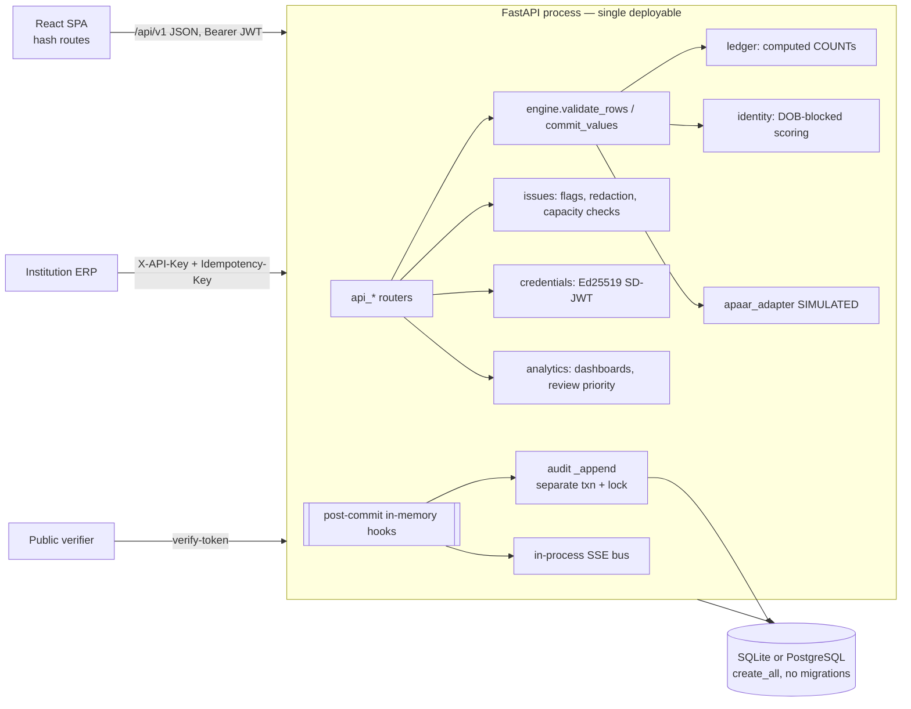

# 03 — Current-system technical audit and baseline

The audit was run on 31 Oct 2026 against branch `claude/busy-newton-qnsfmy` at `b0072e7` (HEAD after merging `origin` at `ab07d85`).
Everything below was **measured or read in this environment**. Where something could not be run, it says so.

## 1. Repository and history

| Item | Finding |
|---|---|
| Remote | `github.com/sanjayvasudevan-c/SIH-2-PS-source_code` |
| Branches | `claude/busy-newton-qnsfmy` (main line of work, default); `codex/sih26263-architecture-v2` (reverted v2 work, see doc 02 §H); `revert-1-codex/…`; `claude/zen-pasteur-ex0v06` (adds a `find-skills` skill file + `skills-lock.json`, no app changes) |
| History shape | 20 commits, linear apart from PR #1 (Codex, merged) → PR #2 (revert) → merge. **No commit on this branch implements any v3-only feature.** |
| Other SIH repo | `sanjayvasudevan-c/SIH_project-repo` is a *different* problem statement (SIH26262, approval workflow). It is not part of this audit. |
| Claims register | `docs/FEATURE_STATUS.yaml`, `scripts/check_claims.py`: **absent on every branch**, although v3 cites them as authoritative |
| CI/CD | **None** (`.github/` absent). Quality gates exist only as `make lint test typecheck tour demos` |

## 2. Technology inventory (actual versions)

| Layer | Technology | Version (pinned) | Source |
|---|---|---|---|
| Runtime | CPython | 3.13.17 in this env; `requires-python >=3.11` | `pyproject.toml` |
| API | FastAPI | 0.162.0 | `requirements.txt` |
| ORM | SQLAlchemy | 2.1.6 | ″ |
| Validation | Pydantic | 2.14.1 | ″ |
| Crypto | cryptography (Ed25519), PyJWT (HS256) | 50.0.2 / 2.15.1 | ″ |
| Files | openpyxl (no defusedxml), csv stdlib | 3.1.5 | ″ |
| DB drivers | sqlite3 stdlib; psycopg[binary] | 3.3.6 | ″ |
| Server | uvicorn[standard] | 0.54.0 | ″ |
| Frontend | React 18.3.1, react-router-dom 6.26.2, Vite 5.4.8, TypeScript 5.6.2 | pinned | `frontend/package.json` |
| Fonts | @fontsource Atkinson Hyperlegible, IBM Plex Mono (self-hosted) | 5.0.x | ″ |
| Tests | pytest 9.1.1, httpx TestClient, Playwright 1.58 (python) | | `requirements-dev.txt` |
| Lint | ruff 0.17.3 | | ″ |
| DB | SQLite (default) / PostgreSQL 16 (tested) | | `config._database_url` |
| Deploy | Dockerfile + compose (unbuilt here); Vercel (`vercel.json`, `api/index.py`), Neon (not attached) | | |
| Not present | Redis, object storage, KMS, workers, Alembic, OpenTelemetry, CI | | |

**Size:**

| Part | Lines | Detail |
|---|---|---|
| Backend Python | 6,752 | 24 modules |
| Frontend TS/TSX | 2,633 | |
| Tests | 1,395 | |

**Surface:** 72 HTTP routes and 24 tables. 23 tables come from the brief, plus `app_secrets` for server-generated secrets on Postgres.

## 3. Baseline: what works and what fails

| Check | Command | Result (this audit) |
|---|---|---|
| Lint | `ruff check backend scripts api` | **pass** |
| Typecheck | `tsc --noEmit` | **pass** |
| Unit/integration tests, SQLite | `pytest -q` | **109 passed**, 0 failed (67 s) |
| Same suite, PostgreSQL 16 | `TEST_DATABASE_URL=postgresql+psycopg://… pytest -q` | **109 passed**, 0 failed (130 s) |
| End-to-end demos A/B/C | `scripts/run_demos.py` (earlier in this session, same code) | all 29 checks pass; audit chain valid (1,448 events) |
| UI tour | `scripts/ui_tour.py` (earlier in this session) | 64 page views, 0 console errors, 0 overflow at 1360/390 px |
| Docker build | `docker compose up` | **not run**: no Docker daemon in this environment |
| Vercel deployment | `apaar-student-register` project | **no deployment exists**. Neon is not attached, so nothing is live and nothing needs preserving. |
| Load test | — | **not run** |

## 4. Performance measurements (new in this audit)

The benchmark script, kept outside the repo, generates 5,000 valid rows with registered (simulated) APAAR IDs. It uploads them for preview and then commits them, after seeding the standard dataset.

| Operation | SQLite (local file) | PostgreSQL 16 (local, TCP loopback) | v3 NFR | Verdict |
|---|---|---|---|---|
| Preview, 5,000 valid rows (full pipeline incl. identity) | **5.7 s** | **11.9 s** | < 30 s | **meets** |
| Preview, 5,000 all-error rows (R006 path, did-you-mean ×5,000) | 4.9 s | 13.8 s | < 30 s | meets |
| Commit, 5,000 rows | 23.2 s | **48.8 s** | not stated | **Exceeds the 60 s Vercel function budget once network latency (Neon) is added**; needs background job |
| National dashboard (seeded + 5,000) | 0.22 s | 0.22 s | p95 < 2 s | meets (single user) |
| Login, wrong password: unknown email vs known email | 9–19 ms vs 149–203 ms | — | — | **timing oracle** (doc 07) |

**Caveats:**
- The synthetic names are near-unique, so identity blocks are small. Real data has dense birthday blocks; see doc 02 §A7.
- These are single-request numbers; no concurrency was tested.

## 5. Architecture as built

Characteristics observed in code:

- **A real modular monolith.** Modules are cleanly separated by file, but **boundaries are not enforced**: there is no import-lint, and modules import each other freely (e.g. `api_students` imports from `api_credentials`).
- **A single-writer engine** (`engine.py`). This holds: every enrolment write goes through `commit_values`, which was verified by grepping for `Enrolment(` and `Student(` constructions outside the engine. Only `seed.py`'s direct registry inserts and tests bypass it.
- **Synchronous everything.** Imports, capacity checks and identity scoring run inside the HTTP request, and there is no worker process.
- **Post-commit side effects** are held in an in-memory list on the SQLAlchemy session (`db.after_commit`), so the audit flush and SSE fan-out are not durable.
- **Schema by `create_all`.** There are no migrations, so adding a column to production is an unmanaged operation.
- **Configuration:** `config.Settings` reads environment variables. Secrets resolve from env, then (on Postgres) `app_secrets` in the same database, then `var/` files.

## 6. Documentation drift

| Document | Drift |
|---|---|
| v3 PDF §25 readiness register | Marks about 15 capabilities PROTOTYPE that are not implemented; doc 02 §B lists them. v3 itself says the table "was not re-verified against code". |
| v3 §11 | R009/R015 meanings differ from code R009. |
| `README.md`, `docs/REQUIREMENTS_TRACEABILITY.md` | Broadly accurate for the code. They describe the SSE "live" feature without noting that it is off on Vercel. They predate v3, so they do not mention rule sets, the outbox or other v3 additions. |
| `docs/PRODUCTION_GAP_ANALYSIS.md` | Accurate and honest; a subset of this audit. |
| `HANDOFF.md` | Accurate as of the last commit; does not mention the demo-video work in progress or this audit. |

## 7. Dead code, duplication and smells

| Item | Location | Note |
|---|---|---|
| `BulkFixIn` model defined but unused (endpoint takes `dict`) | `api_imports.py` | Remove or use; the untyped body weakens OpenAPI |
| `secret_store` + `_secret_file` + env | `config.py`, `secret_store.py` | Three secret sources: intentional but confusing; collapse behind one interface |
| `analytics.review_priority` builds the D003 list by scanning all open D003 issues for every institution (O(institutions × issues)) | `analytics.py` | Fine at 5 institutions; quadratic at national scale |
| `issues.redact` re-queries `Institution` per issue | `issues.py` | N+1 on flag lists |
| Repeated per-row queries in `_repository_rules` (dup enrolment, other-institution enrolments, candidates, transfer check per candidate) | `engine.py` L335–380, `identity.py` L172 | Main cost in commit/preview; batch them |
| Frontend: pages fetch with `any` types | `frontend/src/pages/*` | No generated API client; OpenAPI exists, so generate types |
| Two status vocabularies for integration modes (`SIMULATED/LIVE/NOT_IMPLEMENTED` vs v3 `LIVE/AWAITING/SIMULATED/DISABLED`) | `api_integration.integration_status` | Align with v3 |

## 8. Skills and tools used in this audit (and why)

| Skill / tool | Used for | Why |
|---|---|---|
| Direct repository inspection, pytest, ruff, tsc, PostgreSQL 16 (local) | Baseline, matrix evidence, benchmarks | Measuring beats reading |
| WebSearch (primary sources preferred) | Doc 05 research | `deep-research`/`context7`/`built-in-browser` were not available in this session's skill list; searches were run directly and every source is cited with its reliability |
| Prior Codex branch audit (`docs/CURRENT_STATE_AUDIT.md` on `codex/…`) | Cross-check | An independent second opinion; it agreed on every overlapping finding |
| `gstack`, `superpowers`, `impeccable`, `ui-ux-pro-max` | Not invoked mechanically. Their review lenses (security/CSO, verification-before-completion, UX heuristics) are applied in docs 06–07 | They would add little over direct inspection for a read-only audit; recommended for Phase B (doc 09 §6) |
