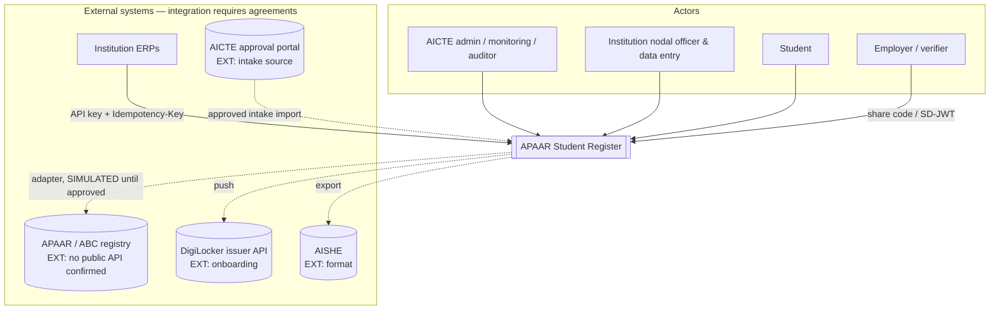
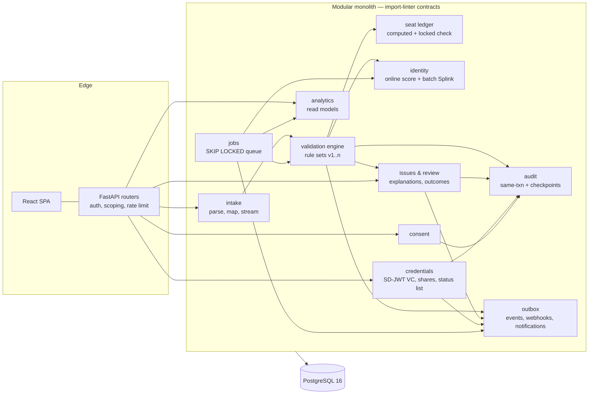
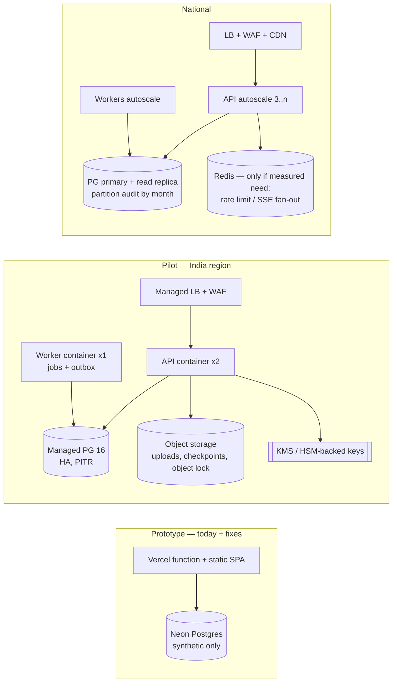
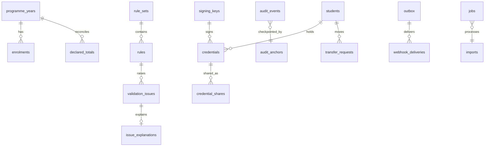

# 08 — Recommended architecture

**Principle:** keep what works (modular monolith, single validation engine, computed ledger, SD-JWT credentials). Close the correctness gaps first, then add asynchronous work using **Postgres primitives before new infrastructure**. Every component below is tagged with the tier where it first becomes necessary:

| Tag | Tier | Scope |
|---|---|---|
| **P** | Prototype / hackathon | Synthetic data, one region, demo |
| **L** | Pilot | 1–3 states, ~500 institutions, real data, India-hosted |
| **N** | National | ~9,000 institutions, ~3–4 M active enrolments |

## 1. System context



## 2. Logical architecture (modules and enforced boundaries)



**Boundary rules** (enforced by `import-linter` in CI):
- Routers may import services, never other routers.
- Only `engine` writes `students`/`enrolments`.
- Only `audit` writes `audit_events`.
- Modules communicate through service functions or outbox events, never by reading each other's tables, with one exception: `analytics` reads any table, read-only.

## 3. Deployment by tier



**Hosting:**
- **Pilot and national:** India-region hosting with a MeitY-empanelled cloud service provider. NIC/MeghRaj is likely preferred by AICTE; the choice is EXT and needs approval.
- **Vercel and Neon:** remain the demo tier only, with synthetic data.

## 4. Data model changes (ERD delta)



Full table and column list: `11-proposed-db-and-api-changes.md`.

## 5. Key flows

### 5.1 Import (large file, pilot tier)

```mermaid
sequenceDiagram
  participant U as Data-entry user
  participant API
  participant J as jobs (SKIP LOCKED)
  participant W as Worker
  participant DB
  U->>API: POST /imports (file, Idempotency-Key from UI)
  API->>DB: store upload (object storage ref) + job PREVIEW
  API-->>U: 202 {import_id}
  W->>J: claim job FOR UPDATE SKIP LOCKED
  W->>DB: stream rows → validate_rows (batched queries)
  W->>DB: preview findings; job DONE; outbox(import.previewed)
  U->>API: GET /imports/{id} (poll / SSE)
  U->>API: POST /imports/{id}/commit
  API->>DB: job COMMIT
  W->>DB: one txn: lock programme_years rows, commit_values, issues, audit rows, outbox
  W-->>U: import.committed (notify)
```

### 5.2 Seat capacity (race-safe)

Inside `commit_values`:
1. Run `SELECT … FROM programme_years WHERE id IN (…) ORDER BY id FOR UPDATE`.
2. Then COUNT the enrolments.
3. Then insert.

Locking the programme-year row serialises concurrent commits for the same programme only, not globally. Locks are taken in id order to avoid deadlocks.

### 5.3 Audit (atomic + verifiable)

1. **Same transaction.** The business transaction inserts the `audit_events` row with `seq` null.
2. **Chaining.** A single chainer, either the worker or a statement trigger under advisory lock `726263`, assigns `seq` and `prev_hash`/`hash` in order.
3. **Checkpoints.** Hourly, sign `{seq, head_hash, ts}` with an Ed25519 key, store it in `audit_anchors`, and copy it to object-locked storage.
4. **Verification** checks the links plus the latest anchor, which detects truncation.

### 5.4 Verification with share codes

```mermaid
sequenceDiagram
  participant S as Student
  participant API
  participant V as Verifier
  S->>API: POST /credentials/{id}/shares {claims, ttl}
  API-->>S: code (128-bit), QR → /#/v/{code}
  V->>API: POST /verification/share {code}
  API->>API: hash(code) lookup, not expired/revoked, consent ok, minor hold ok
  API-->>V: verified claims + status + issuer kid (no undisclosed fields)
  API->>API: audit verification.performed; student access log
```

### 5.5 Identity resolution

- **Online (per row, P):** the current DOB-blocked score, with batched candidate loading and a block-size cap. When a block exceeds the cap, the flag says "dense block, deferred to batch" instead of scanning.
- **Batch (nightly, L):** Splink with the DuckDB backend over pseudonymised features (normalised name tokens, DOB, gender, state). Writes `identity_candidates` with `model_version` and the weight breakdown, and opens D003-style flags only above the reviewed threshold.
- **Quality gate:** a golden set in CI, with precision/recall per threshold (F-07).

## 6. AuthN / AuthZ

| Concern | Prototype | Pilot | National |
|---|---|---|---|
| Staff login | Password + JWT (fix S1/S3) | Password + TOTP for AICTE roles; short access token + httpOnly refresh cookie; `token_version` | SSO with AICTE identity provider / Parichay if approved (EXT) |
| Institution systems | API key (hashed) + scopes | + IP allow-list option; key rotation | mTLS optional |
| Students | Demo login | OTP to registered mobile (SMS gateway EXT) or DigiLocker OAuth (EXT) | DigiLocker / APAAR SSO (EXT) |
| Verifiers | Any VERIFIER account | Organisation registration + approval | Same |
| Authorisation | `require_role` + per-router scoping | Central `scoped(query, principal)` helper + generated cross-tenant tests | + PostgreSQL RLS as defence in depth |

## 7. Security architecture

The controls below are detailed in doc 07.

- **Edge:** WAF, rate limiting, CSP and HSTS.
- **Application:**
  - Central scoping.
  - Parser hardening.
  - No PII in logs. A log filter reuses the `_SENSITIVE_KEYS` list plus name fields.
- **Data:**
  - Encryption at rest is provided by the managed DB.
  - Column-level encryption for mobile and email (pilot).
  - Retention jobs.
- **Keys:**
  - The JWT secret and signing keys live in KMS.
  - A `signing_keys` registry (`kid`, status, `not_after`) is published at `/.well-known/jwks.json`.
- **Supply chain:** CI scanners, pinned dependencies, and an SBOM (`cyclonedx`).

## 8. ML / analytics

**ML is justified in exactly two places:**
1. **Identity matching:** Splink, an unsupervised probabilistic Fellegi–Sunter model with explainable weights.
2. **Threshold calibration** from reviewer outcomes (F-08).

Everything else uses transparent statistics, because there are no labels and flags have reputational impact:
- peer z-scores, suppressed when fewer than 8 peers;
- the forecast quantile band (F-06);
- access-anomaly robust z-scores (F-14).

No black-box scoring of institutions.

## 9. Observability

| Signal | Prototype | Pilot |
|---|---|---|
| Logs | stdout JSON | + central log store, PII filter, 90-day retention |
| Metrics | `/healthz`, `/system/status` | OpenTelemetry → Prometheus/managed; RED metrics per route; job queue depth/age; outbox lag |
| Traces | — | OTel traces for import and commit |
| Business SLOs | — | Preview p95 < 30 s for 5k rows; dashboard p95 < 2 s; verification p95 < 500 ms; outbox lag < 60 s |
| Alerts | — | Audit chain verify failure; outbox lag; job failures; 5xx rate; login failure spike |

## 10. Recovery and incident response

- **Backups:** PITR with 7 days at pilot and 35 days nationally; a monthly restore drill that verifies the audit chain against the anchors.
- **Targets:**

  | Tier | RPO | RTO |
  |---|---|---|
  | Pilot | ≤ 5 min | ≤ 4 h |
  | National | ≤ 1 min | ≤ 1 h |

  These are targets to confirm with AICTE.
- **Incident runbook:**
  1. Detect.
  2. Contain: revoke keys, disable API keys.
  3. Assess personal-data impact.
  4. Notify within the statutory windows (CERT-In 6 h; DPDP Board per the Rules, doc 05 R10). The legal owner is AICTE.
  5. Post-mortem.
- **Key compromise:**
  1. Mark the `kid` revoked.
  2. Update the status list.
  3. Run the re-issue job.
  4. Publish a notice.

## 11. Testing strategy

| Layer | Tooling | Gate |
|---|---|---|
| Unit + integration | pytest on SQLite **and** PG16 (both exist today) | CI required |
| Contract | OpenAPI snapshot diff; generated TS client compile | CI required |
| Boundaries | import-linter | CI required |
| Claims | `check_claims.py` vs FEATURE_STATUS.yaml + JUnit | CI required |
| Security | Generated cross-tenant tests; parser fuzz; auth; pip-audit; gitleaks | CI required |
| Concurrency | Last seat; D003 race; issue dedupe (PG only) | CI required |
| Identity quality | Golden set P/R thresholds | CI required (fail if recall < target) |
| E2E | Existing Playwright tour + demos A/B/C | CI on main |
| Performance | 5k-row preview/commit benchmark (script exists) | Nightly, trend tracked |
| Accessibility | axe-core in the Playwright tour | Warn → required by pilot |

## 12. ADR summary (proposed; see `12-adr-proposals.md`)

| ADR | Decision |
|---|---|
| ADR-101 | Postgres job queue (SKIP LOCKED) + outbox; Redis deferred |
| ADR-102 | Audit written in the business transaction; signed checkpoints |
| ADR-103 | Alembic migrations (adopt from the Codex branch) |
| ADR-104 | Programme-year row lock for capacity checks |
| ADR-105 | Share codes replace token-in-URL |
| ADR-106 | Splink batch identity + golden set |
| ADR-107 | Claims register enforced in CI |
| ADR-108 | India-region hosting for any real data; Vercel demo-only |
| ADR-109 | Central scoping helper now, RLS at pilot |
| ADR-110 | Short-lived access tokens + httpOnly refresh, `token_version` |
