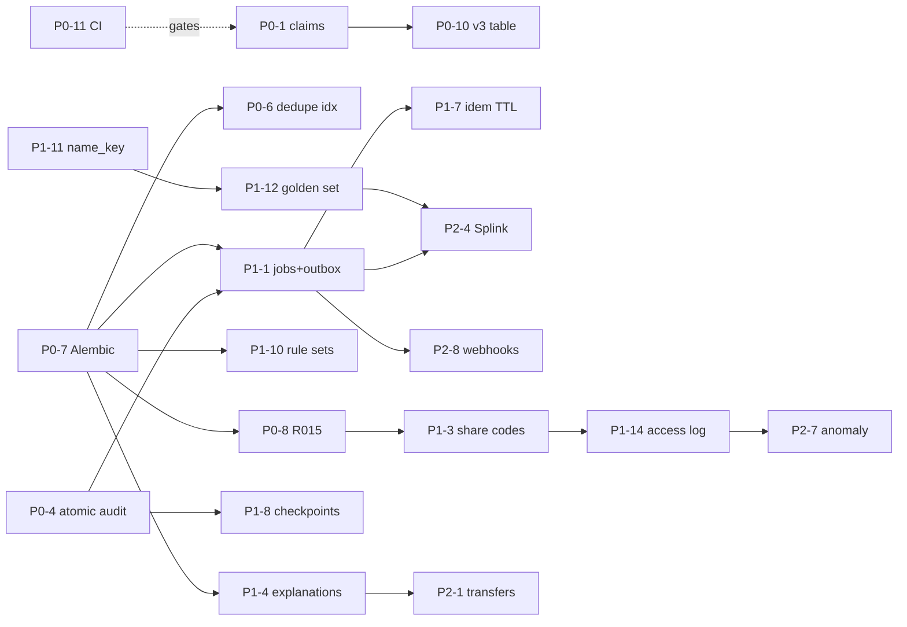

# 09 — Implementation roadmap

Each item lists:
- **Why**: why it is needed.
- **Files**: files touched.
- **Risk**: risk of the change.
- **Accept**: acceptance test.
- **Size**: S < ½ day, M 1–2 days, L 3+ days.
- **Dep**: dependencies.

Items marked **♻ Codex** have a reviewed starting point on branch `codex/sih26263-architecture-v2`. Port them selectively; don't re-merge the branch.

## P0 — correctness and honesty (before any further demo or deploy)

| # | Item | Why | Files | Risk | Accept | Size | Dep |
|---|---|---|---|---|---|---|---|
| P0-1 | Claims register + `check_claims.py` + `/system/status` (F-01) | v3 cites it; ~15 false claims | `docs/FEATURE_STATUS.yaml`, `scripts/check_claims.py`, `api_system.py`, a page | Low | Script fails on a fake claim; page lists every claim with its test | S | — |
| P0-2 | Parser hardening (S5) ♻ Codex | Zip/XML bomb; rows read before cap | `intake.py`, requirements (+`defusedxml`, **needs install approval**) | Low | Bomb fixture rejected < 1 s; 50,001 rows → 413 | S | — |
| P0-3 | Login timing + demo-accounts gate + lockout scope (S1–S3) | Auth defects | `api_auth.py`, `config.py` | Low | Timing, gate and lockout tests | S | — |
| P0-4 | Atomic audit (S7) | Lost events undetectable | `audit.py`, `db.py`, callers | **Med**: touches every write | Fault-injection test; chain valid after 1,000 mixed ops on PG | M | — |
| P0-5 | Capacity row lock (ADR-104) | Last-seat race | `engine.py`, `ledger.py` | Med | Two-thread last-seat test on PG → one admitted | S | — |
| P0-6 | Issue dedupe unique index (S16) | Duplicate flags | `models.py`, `issues.py` | Low | Concurrent test | S | P0-7 |
| P0-7 | Alembic baseline migration ♻ Codex | `create_all` can't evolve prod | `backend/alembic/*` | Low | `alembic upgrade head` on empty PG == `create_all` schema (diff test) | S | — |
| P0-8 | Minor guardian-consent hold R015 (F-03) ♻ Codex | Legal | engine rule, `students` column, verification check, template | Low | Under-18 verify → held | S | P0-7 |
| P0-9 | R009 code collision vs v3 numbering | Docs vs code mismatch | rules, docs | Low | Rule catalogue matches v3 table | S | — |
| P0-10 | Fix v3 §25 readiness table via the claims register output | Honesty | docs only | None | Regenerated table | S | P0-1 |
| P0-11 | CI workflow | No gates | `.github/workflows/ci.yml` | None | Green run: ruff, tsc, pytest SQLite + PG service, claims | S | — |

## P1 — pilot-critical

| # | Item | Why | Size | Dep |
|---|---|---|---|---|
| P1-1 | Postgres jobs + outbox + worker entrypoint (ADR-101); background preview/commit; UI Idempotency-Key | 49 s commit; timeouts | L | P0-4, P0-7 |
| P1-2 | Batched queries in `_repository_rules`/identity; dense-block cap | Per-row queries; DOB scans | M | — |
| P1-3 | Share codes (F-04) + minor/consent checks in one verification service | Token-in-URL | M | P0-8 |
| P1-4 | Explanation objects + resolution outcomes + rule metrics (F-02) | FP calibration | M | P0-7 |
| P1-5 | Central scoping helper + generated cross-tenant tests (S15) | Tenant isolation | M | — |
| P1-6 | Token hardening: refresh cookie, `token_version`, CSP/headers (S10, S11) | Session security | M | — |
| P1-7 | Idempotency record minimisation + TTL purge (S13) | PII retention | S | P1-1 |
| P1-8 | Signed audit checkpoints (F-16, S8) | Truncation | S | P0-4 |
| P1-9 | Key registry + JWKS + KMS adapter interface (S9) | Key custody | M | — |
| P1-10 | Versioned rule sets with impact preview + four-eyes (doc 04) | Mid-season rule changes | M | P0-7 |
| P1-11 | Non-Latin `name_key` + Indic transliteration fold ♻ Codex | Identity accuracy | S | — |
| P1-12 | Golden set + P/R in CI (F-07, part 1) | Identity claims evidence | M | P1-11 |
| P1-13 | Completeness tracker + pre-declaration checklist (F-10) | Deadline metric | S | — |
| P1-14 | Student access log + consent revocation | DPDP rights | S | P1-3 |

## P2 — high-value differentiators

| # | Item | Size | Dep |
|---|---|---|---|
| P2-1 | Transfer workflow (F-15) | M | P1-4 |
| P2-2 | Seat-advice report + embeddable widget (F-05) | S–M | — |
| P2-3 | Reconciliation against declared totals (F-12) | M | P0-7 |
| P2-4 | Splink batch dedup job (F-07, part 2) | L | P1-1, P1-12; **dependency install approval** (splink, duckdb) |
| P2-5 | Smart spreadsheet mapping (F-09) | M | — |
| P2-6 | Utilisation forecast (F-06) | M | — |
| P2-7 | Access-anomaly report (F-14) | M | P1-14 |
| P2-8 | Webhooks to institution ERPs via outbox | M | P1-1 |
| P2-9 | Hindi labels for the institution flow; axe-core gate | M | — |

## P3 — future / requires external approval

| # | Item | External dependency |
|---|---|---|
| P3-1 | Real APAAR verification adapter | MoE/ABC API access and agreement; **no public API confirmed** |
| P3-2 | DigiLocker push (F-18) | Issuer onboarding through API Setu |
| P3-3 | AISHE export in the official format (F-11) | Format confirmation from MoE |
| P3-4 | Approval-portal intake import | AICTE IT data feed |
| P3-5 | SSO for AICTE staff | AICTE IdP / Parichay |
| P3-6 | Institution approval credential (F-17) | AICTE policy |
| P3-7 | NL analytics (F-13) | Approval for LLM use and its data residency |
| P3-8 | India-region pilot hosting; VAPT; STQC/CERT-In-empanelled audit | Procurement |

## Dependency-aware sequence

**Suggested execution:**

| Batch | Work | Estimate |
|---|---|---|
| 1 | P0-11, P0-1, P0-2, P0-3, P0-7 | ~2 days |
| 2 | P0-4, P0-5, P0-6, P0-8, P0-9, P0-10 | ~3 days |
| 3 | P1-1, P1-2 (performance) | ~4 days |
| 4 | Remaining P1 security/UX items | ~6 days |
| 5 | P2, in priority order | — |

Each batch ends with the full suite on SQLite and PG16, the demos, and the UI tour.

## Approvals needed from you before Phase B

1. **Package installs:**
   - `defusedxml` (P0-2)
   - `alembic` (P0-7)
   - `import-linter` (CI)
   - later: `splink` + `duckdb` (P2-4)
2. **Schema changes** via the first Alembic migration: new columns and tables per doc 11.
3. **Behaviour changes visible in the demo:**
   - `/auth/demo-accounts` hidden unless `DEMO_MODE=true`; the demo deploy would set it.
   - Minors held.
   - Share-code QR.
4. **Porting from the Codex branch** (it was reverted; confirm you're fine with reusing its code selectively).
5. **Deployment:** none until you confirm. The Neon attachment is still pending.

## Skills to use in Phase B

| Skill | When |
|---|---|
| `superpowers` (TDD, verification-before-completion) | Every P0/P1 item: test first, prove it fails, fix |
| `gstack` `/cso` and `/review` | After batches 2 and 4 |
| `security-review` | Before any deploy |
| `impeccable` / `ui-ux-pro-max` | P1-13, P2-5 and P2-9 UI work |
| `webapp-testing` | Extend the tour with axe-core and the new flows |
